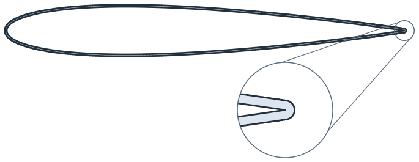
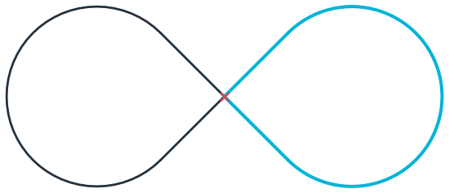
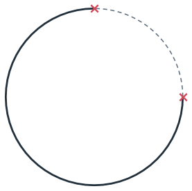
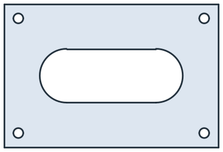
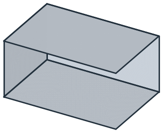
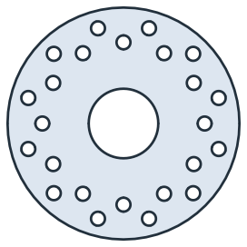
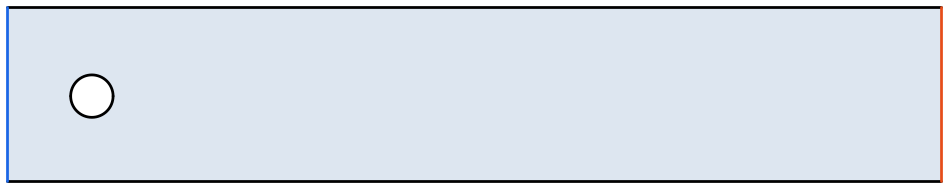
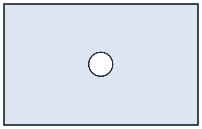
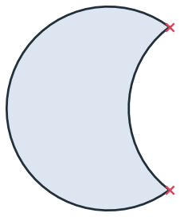
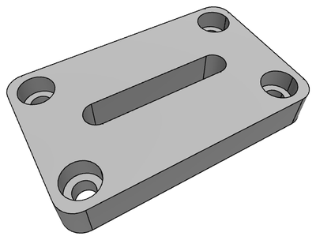

# Basics

[<em class="px-tag">Example</em> A toy plane from sketches on planes in 3D](../../examples/toy-plane.md)
[A brake disc: one hole, 24 copies](../../core/basics/motions.md)
[A coating offset from an airfoil spline](../../core/basics/splines.md)

planex2d has a small set of geometry objects, each with clearly defined properties. Edges can be lines, circular arcs
or full circles, or splines. Lines and circular edges use exact geometry.

A wire is one chain of edges, open or closed, that does not cross, overlap or branch. A figure eight, for example,
consists of two wires, and so does a T. A face is one region bounded by an outer loop and any holes, with no
overlapping regions, free edges or zero-length edges. A shape groups faces and wires that have been cut against each
other, and faces that meet share their edges. A compound is a simple collection of objects.

Every wire, face and shape lies in a plane that can be positioned anywhere in 3D. Names, colors and mesh sizes travel
with the geometry through Boolean operations and export. Geometry has no built-in unit. Lines and arcs are exact, and
rounding matters only where two independent computations have to agree. See [Objects in planex2d](objects.md) for an
overview of the geometry model.

In this section

## Objects

- [Objects in planex2d](objects.md)
- [Lines and arcs](edges.md)
- [Splines](splines.md)
- [Wires and faces](wires-and-faces.md)
- [Faces, shapes and compounds](faces-shapes-compounds.md)

[<b>Objects in planex2d</b>The geometry objects, their guarantees and how to construct them.](objects.md)
[<b>Lines and arcs</b>Lines, circular arcs and full circles, with shared vertices and edge data.](edges.md)
[<b>Splines</b>Smooth curves in Boolean operations and offsets, from airfoils to cams.](splines.md)
[<b>Wires and faces</b>Building wires and faces from edges, with holes determined by nesting.](wires-and-faces.md)
[<b>Faces, shapes and compounds</b>Boolean results, regions built from wires and faces that share edges.](faces-shapes-compounds.md)

## In space

- [The plane in 3D](plane.md)
- [Moving, rotating, mirroring, scaling](motions.md)

[<b>The plane in 3D</b>Working on any plane, including a solid face or another object&#x27;s plane.](plane.md)
[<b>Moving, rotating, mirroring, scaling</b>Transformations, symmetry and patterns, from a T-slot nut to a brake disc.](motions.md)

## Data

- [Names and colors](properties.md)
- [Units](units.md)
- [Tolerances](tolerances.md)

[<b>Names and colors</b>Names, colors and mesh sizes on edges, faces and vertices, including their behaviour in Boolean operations.](properties.md)
[<b>Units</b>Geometry has no built-in unit; learn how to interpret lengths and imported files.](units.md)
[<b>Tolerances</b>Where geometric calculations are exact and where floating-point rounding matters.](tolerances.md)

## 3D

- [Pad and Pocket](pad-pocket.md)

[<b>Pad and Pocket</b>Solids from faces and sketches, extruded and cut with OpenCASCADE, named after the profile.](pad-pocket.md)
