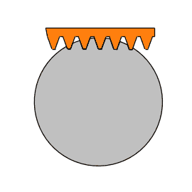
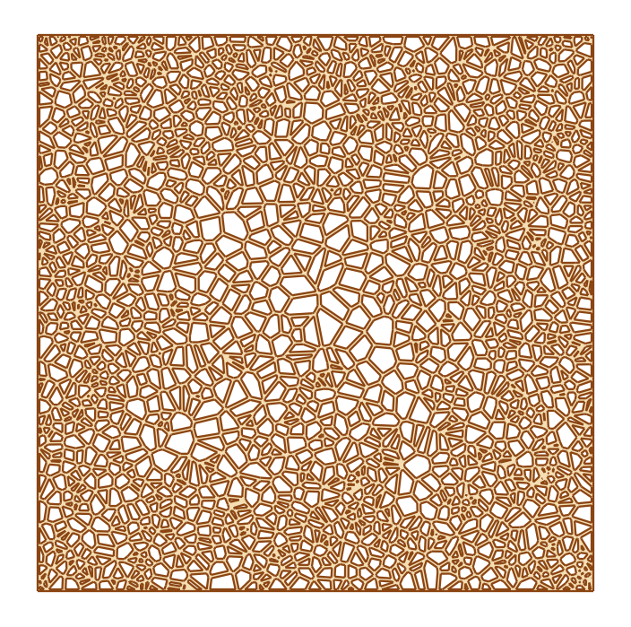
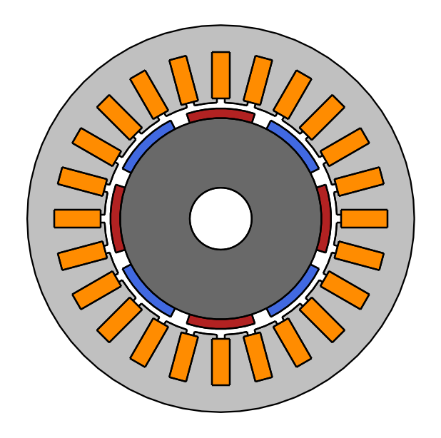
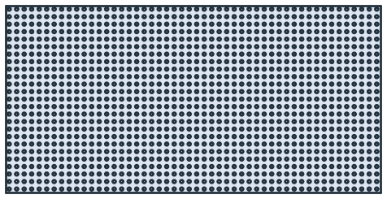
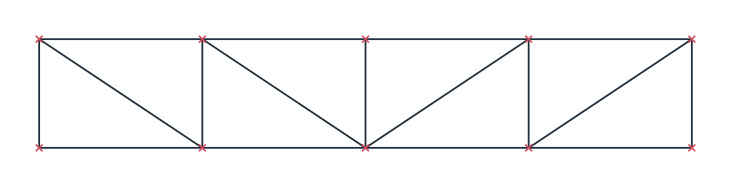
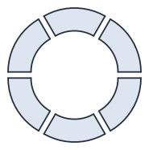

# Booleans

- [Two faces](two-faces.md)
- [Many faces at once](many-faces.md)
- [Faces and wires](faces-and-wires.md)
- [Splitting and trimming](split-trim.md)
- [Traces and pads](traces.md)

[<em class="px-tag">Example</em> A gear cut by its rack: one subtraction per position](../../examples/gear-cutting.md)
[<em class="px-tag">Example</em> A bone scaffold: some 6000 struts united](../../examples/voronoi-bone.md)
[<em class="px-tag">Example</em> A motor lamination glued into its regions](../../examples/motor.md)
[<em class="px-tag">Example</em> The moving sofa as one intersection](../../examples/moving-sofa.md)

Faces combine with `+` (union), `-` (difference) and `*` (intersection), and lists of faces with `px.Unify`,
`px.Subtract` and `px.Intersect`, which run on all cores. Every edge is cut where it meets an edge of the other
operand. After that, each piece lies wholly inside, wholly outside or on the boundary of the other operand, so one
test at its midpoint decides whether it stays. Where edges meet, they share one bit-exact vertex, so no gap remains
between them, and the areas agree with their formulas up to rounding. Lines, arcs and full circles stay exact, and the
result is a shape of clean faces, ready for the next operation.

`px.Glue` keeps the parts as regions that share their common edges, which is what a mesher needs for several
materials. See [Faces, shapes and compounds](../basics/faces-shapes-compounds.md) for gluing faces. `Split` and `Trim`
cut faces and wires along any curve.

In this section

[<b>Two faces</b>Union, difference and intersection of two faces, keeping names and colors.](two-faces.md)
[<b>Many faces at once</b>Unify, Subtract and Intersect on lists, as a balanced tree on all cores.](many-faces.md)
[<b>Faces and wires</b>Wires united and glued, as in a truss built from its member center lines.](faces-and-wires.md)
[<b>Splitting and trimming</b>A face cut along any curve, from segments to trimmed blanks and punched holes.](split-trim.md)
[<b>Traces and pads</b>Offsets of paths, round pads and drills, with every edge named after its net.](traces.md)

## Everything at a glance

| | |
|---|---|
| **Two faces** | `a + b`, `a - b`, `a * b`, `a += b`, `a -= b`, `a *= b` |
| **Many faces** | `px.Unify(faces)`, `px.Intersect(faces)`, `px.Subtract([first, *others])`, on all cores |
| **Wires** | `wire + wire` unites wires; `face + wire` raises a `TypeError`. |
| **Glue** | `px.Glue(parts)` cuts faces and wires against each other. Faces that touch share their edges. Two overlapping parts give three faces, each part alone and the overlap, which takes the first part's properties. A part entirely inside another keeps its own region and properties, and a wire through a face splits it. |
| **Splitting** | `Split(cutter)`, `Trim(cutter, keep_closest_to=, remove_closest_to=, keep_largest=, keep_smallest=, keep_left=, keep_right=)` |
