# Constraint sketches

[<em class="px-tag">Example</em> Jansen&#x27;s leg: one sketch, the crank angle updated](../../examples/jansen-linkage.md)
[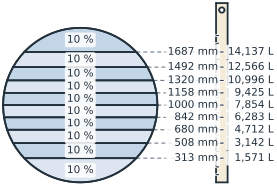A dipstick: every mark solved for 10 % of the volume](../../core/constraints/formulas.md)
[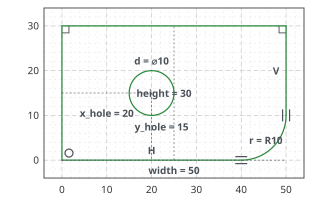A plate, fully constrained, with every constraint shown](../../core/constraints/kinds.md)

A constraint sketch, `px.Sketch`, supports every drawing call of `px.QuickSketch`: lines, arcs, circles and splines
from references, construction elements, offsets, trimming and mirroring (see [Quick sketch](../sketch/index.md)). In
addition, it keeps constraints that turn a rough drawing into an exact one, such as a line that must be horizontal, an
arc that must be tangent, or a hole 8 in diameter and 40 from the center. planex2d solves these constraints, moves
every element as little as they allow, and shows what is still free.

Every dimension has an id, and setting a dimension solves the sketch again, so the sketch becomes a parametric part.
Expressions tie dimensions together as design rules. The same solver also moves mechanisms: given a crank angle, it
returns the position of every joint. The solved sketch exports like any other, as faces, wires, OpenCASCADE shapes and
netgen geometries.

In this section

## Constraining

- [Drawing with constraints](drawing.md)
- [Converting sketches](converting.md)
- [Constraints and dimensions](kinds.md)
- [Fully, under- and over-constrained](diagnosis.md)

[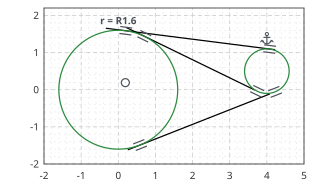<b>Drawing with constraints</b>Flags in the drawing calls, helpers as constraints, and how the drawing decides which tangent is meant.](drawing.md)
[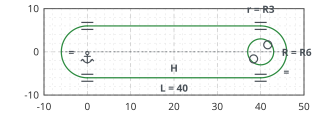<b>Converting sketches</b>A quick sketch turned into a constraint sketch with the constraints it shows, and back, and a sketch from a solid&#x27;s face.](converting.md)
[<b>Constraints and dimensions</b>Every kind of constraint, reference dimensions, and how the sketch shows them.](kinds.md)
[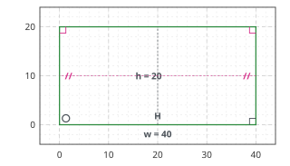<b>Fully, under- and over-constrained</b>Finding what is still free, what is redundant and what conflicts.](diagnosis.md)

## Changing the design

- [Changing dimensions](update.md)
- [Expressions: design rules](expressions.md)
- [Formulas: a dipstick for a tank](formulas.md)

[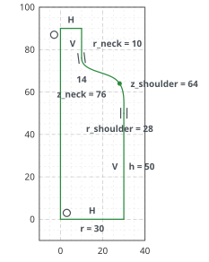<b>Changing dimensions</b>A parameter study with Update, walking in steps, and branch changes.](update.md)
[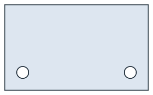<b>Expressions: design rules</b>Equations between dimensions, so that one number drives a family of parts.](expressions.md)
[<b>Formulas: a dipstick for a tank</b>Every mark of a dipstick solved for an equal share of the volume.](formulas.md)

## More geometry

- [Symmetry and patterns](symmetry.md)
- [Splines](splines.md)
- [Trim, split and project](trim.md)
- [Offsets and profiles revisited](offsets-profiles.md)

[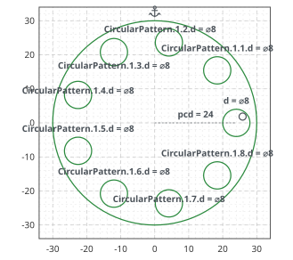<b>Symmetry and patterns</b>Mirrored halves, symmetry lines and circular patterns.](symmetry.md)
[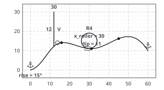<b>Splines</b>Splines with constraints, from a bottle to a cam and its roller.](splines.md)
[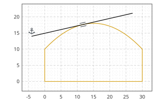<b>Trim, split and project</b>Cuts that follow the dimensions, and OpenCASCADE geometry as references.](trim.md)
[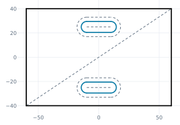<b>Offsets and profiles revisited</b>Slot widths, fillet radii and offset distances as dimensions, with offsets that follow their sources.](offsets-profiles.md)

## Beyond drawings

- [Mechanisms: the sketch as a solver](mechanisms.md)

[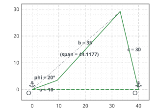<b>Mechanisms: the sketch as a solver</b>A four-bar linkage and its coupler curve, solved position by position.](mechanisms.md)
