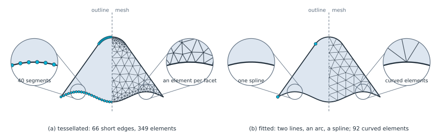
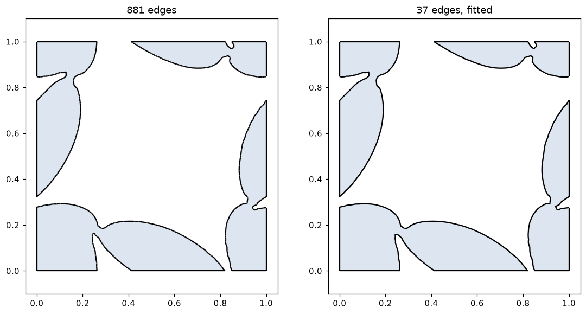
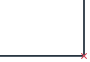
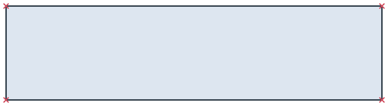
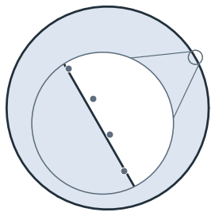
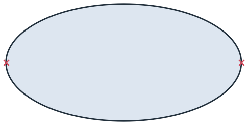

# Defeaturing and simplification

- [Small gaps](gaps.md)
- [Small edges](small-edges.md)
- [Collinear lines](collinear.md)
- [Fitting arcs](arcs.md)
- [Fitting splines](splines.md)


[<span>Short segments turned back into lines, an arc and a spline</span>](../../core/defeaturing/arcs.md)
[<span>A shape optimization result, fitted with splines</span>](../../integrations/netgen/levelset.md)


Imported and computed geometry often contains details that a mesher cannot use: ends that miss each other by a hair,
edges far shorter than the part, straight runs in many pieces, and arcs or free-form curves tessellated into short
segments. `Simplify` cleans these up in place, `Simplified` returns a cleaned copy, and the exports to OpenCASCADE and
netgen run the same steps. Gaps, small edges and collinear pieces are handled below 10⁻⁷ by default, the resolution
of OpenCASCADE and netgen. Fitting arcs and splines is switched on when needed, and every fit is checked against the
edges it replaces and rejected if it strays further than its tolerance.

<p class="px-label">In this section</p>


[<b>Small gaps</b><span>Ends that miss each other, joined within a tolerance.</span>](gaps.md)
[<b>Small edges</b><span>Edges shorter than a tolerance, removed with their ends merged.</span>](small-edges.md)
[<b>Collinear lines</b><span>Straight runs in several pieces, joined into one line.</span>](collinear.md)
[<b>Fitting arcs</b><span>A measured bore turned back into three arcs, with the tolerance and the checks.</span>](arcs.md)
[<b>Fitting splines</b><span>A tessellated ellipse turned back into two B-splines.</span>](splines.md)


## The steps, in order

| Step | Option | Default |
|---|---|---|
| Close small gaps | `close_gaps_smaller` | `1e-7` |
| Merge collinear lines | `merge_collinear_closer` | `1e-7` |
| Fit arcs | `fit_arcs`: `True`, or a dict of `tol`, `max_edge_length`, `max_edge_angle`, `ignore_edges_smaller` | Off |
| Fit splines | `fit_splines`: `True`, or a dict of the same options | Off |
| Remove small edges | `remove_edges_smaller` | `1e-7` |
| Remove free edges (touching no other edge at either end) | `remove_free_edges` | On for faces, off for wires |
| Remove small faces | `remove_faces_smaller`, `merge_small_faces_instead` | `0` (none) |

The defaults are stored in `px.config` and can be changed for the whole session. A dict for a fit changes the options
it names and switches the fit on:

```python
import planex as px

px.config.fit_arcs = dict(tol=1e-4)
print(px.config.fit_arcs)
```

```text
{'enabled': True, 'tol': 0.0001, 'max_edge_length': 0.0001, 'max_edge_angle': 30.0, 'ignore_edges_smaller': 1e-05}
```
