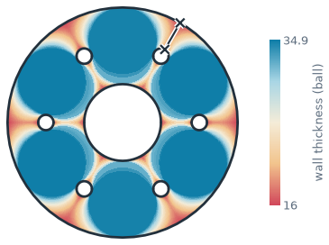
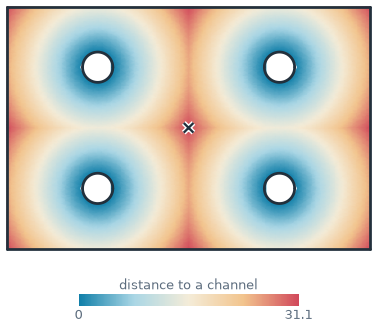
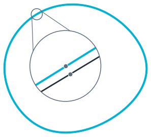
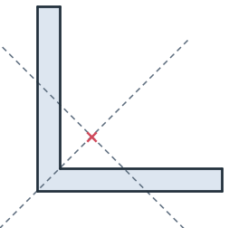
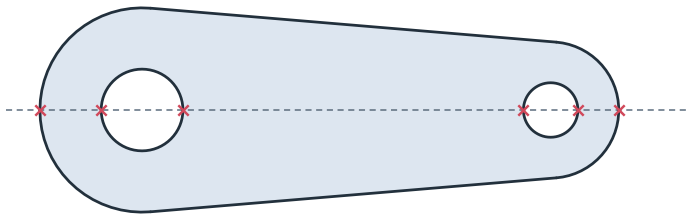
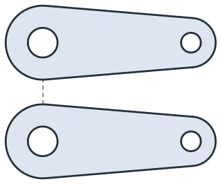
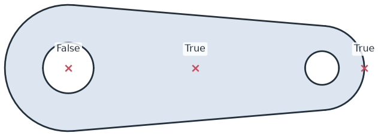
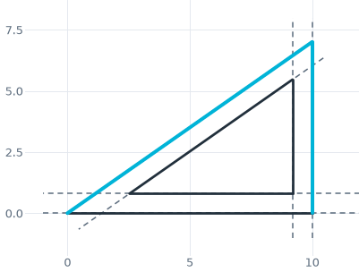

# Measuring

[A flange&#x27;s wall thickness, mapped over the part](../../core/measuring/analysis.md#A-flange-that-measures-itself)
[Channels placed by SciPy, so that no point is far from one](../../core/measuring/analysis.md#Thermal:-the-hottest-spot-of-a-cold-plate)
[How far a polygon strays from its cam](../../core/measuring/analysis.md#How-far-apart-two-curves-are)
[<em class="px-tag">Example</em> A coast measured with dividers](../../examples/coastline-paradox.md)

Every object provides its area, length, center and bounding box directly, and `Measure()` returns them all as a dict
together with the second moments and principal axes. Distances, closest points and inside tests take a point or an
array of points. In a sketch, `Measure(id)` measures elements by their ids, so a drawing can be checked against its
intent.

A measurement can also be a function of your own, stored on a sketch and evaluated again after every change, such as
the thinnest wall, the largest end mill that fits, or the point farthest from a cooling channel.
`planex.measurements` provides thickness maps, clearances, Hausdorff distances and torsion constants. See
[Field solvers as measurements](../../integrations/netgen/field-solvers.md) for measurements that need a field
solver.

In this section

## Measurements

- [Areas, centroids and second moments](sections.md)
- [Boxes, crossings and open ends](queries.md)
- [Distances and clearances](distances.md)
- [Inside or outside](inside.md)
- [Dimensions in a sketch](sketch-dimensions.md)

[<b>Areas, centroids and second moments</b>Measure() as a dict, and the centroids and principal axes of two sections.](sections.md)
[<b>Boxes, crossings and open ends</b>Bounding boxes, edges by name, crossings, and the outline and holes.](queries.md)
[<b>Distances and clearances</b>Shortest distances and connections, in the plane and in 3D.](distances.md)
[<b>Inside or outside</b>Points tested against a face, one at a time or by the thousand.](inside.md)
[<b>Dimensions in a sketch</b>Lengths, angles and distances of sketch elements, by their ids.](sketch-dimensions.md)

## Analysis

- [Part analysis](analysis.md)

[<b>Part analysis</b>Measurements as functions, from thickness maps to checks that follow the sketch and optimization.](analysis.md)

## Everything at a glance

| | |
|---|---|
| **Size** | `mass` (the area of faces, the length of wires), `bounding_box`, `outer`, `inner` |
| **Mass properties** | `center` (3D), `inertia` (3D, about the center), `Measure()`: `Ih`, `Iv`, `Ihv`, `I1`, `I2`, `principal_angle` |
| **Distances** | `Distance(target, project=False, components=None, signed=False)`, `ClosestPoint(point)` |
| **Inside** | `Contains(point, boundary=True)` |
| **Edges** | `Distance(..., on_carrier=True)`, `Measure(to=...)` |
| **Sketches** | `sketch.Measure(id, to=...)`: lengths, radii, angles and distances between elements, by id |
| **Analysis** | [Selectors](analysis.md) by id, name, kind and position; `vertex.angle`, `vertex.radius`; `planex.measurements` with thickness maps, clearance, Hausdorff distance and torsion; `Measure(f, id=...)`, `measures` |

See [Field solvers as measurements](../../integrations/netgen/field-solvers.md) for measurements that need a field
solver, NGSolve or FEniCSx, such as a peak temperature or a stress concentration.
