# Plotting

[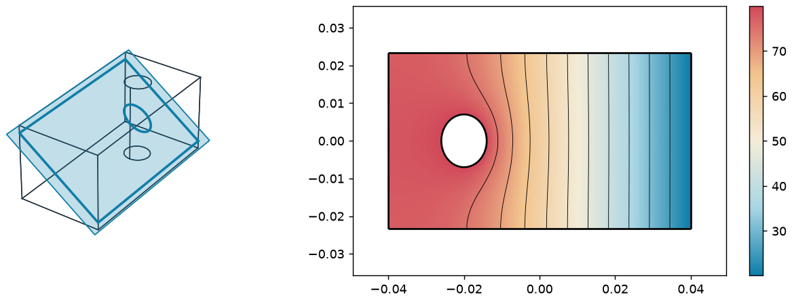A 3D result cut by a plane, and the field in the cut](../../integrations/netgen/fields.md#Cutting-a-3D-part)
[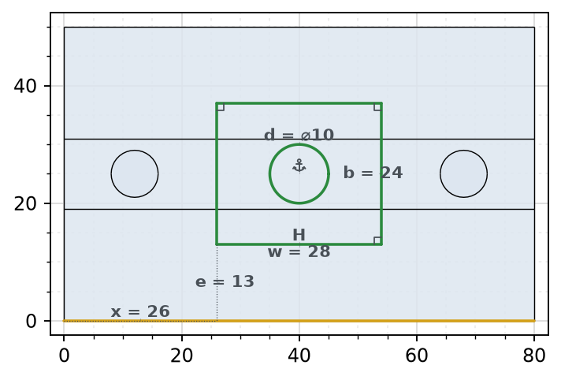A constraint sketch on the solid it lies on](sketches.md#On-a-solid)
[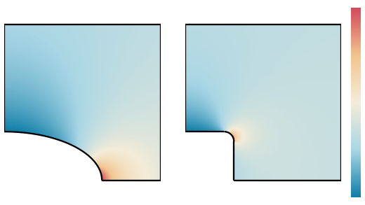<em class="px-tag">Example</em> Airplane windows: where the stress collects](../../examples/airplane-windows.md)

planex2d draws its objects with matplotlib or plotly, every edge from its exact curve. `px.Plot` takes faces, shapes,
wires, compounds and sketches, and in Jupyter, every object shows itself as an SVG picture without a call. `px.Plot3d`
draws the objects on their planes in 3D, next to OpenCASCADE solids.

A plot is also a check of the geometry. Marks show tiny edges, open ends and chosen edges, `line_col="type"` gives
lines, arcs and splines a color each, and a sketch is drawn in the colors of its constraint state. `px.PlotField`
draws measurements and simulation results from NGSolve or FEniCSx on the same geometry, from wall thickness maps to
temperatures with contours, arrows and field lines.

In this section

## General

- [matplotlib](matplotlib.md)
- [plotly](plotly.md)
- [SVG](svg.md)
- [Marking edges](marks.md)
- [In 3D](in-3d.md)

[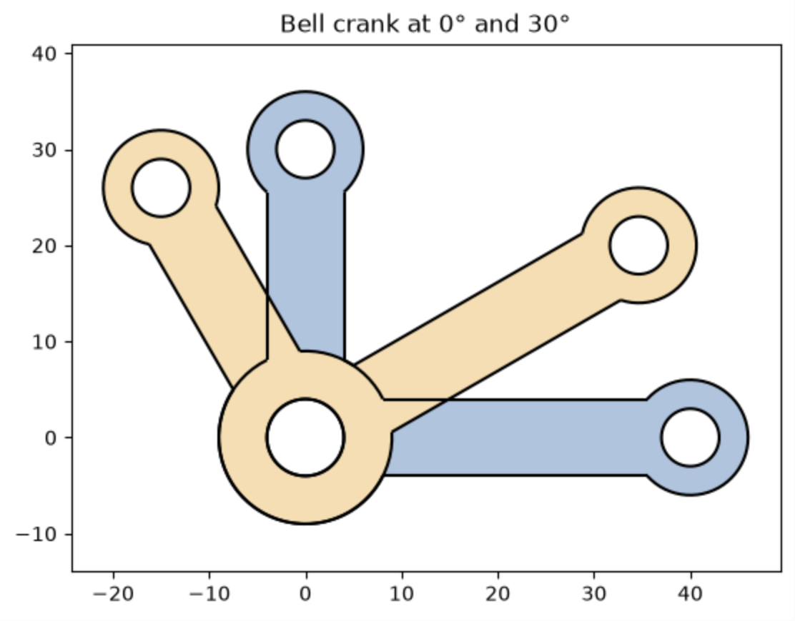<b>matplotlib</b>Plot returns the Axes, for several objects in one figure, panels and saving.](matplotlib.md)
[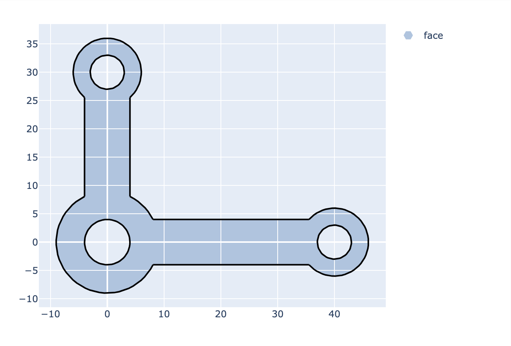<b>plotly</b>Interactive plots to zoom and pan, saved as HTML.](plotly.md)
[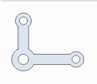<b>SVG</b>The picture Jupyter shows, as text, with arcs as exact SVG arcs.](svg.md)
[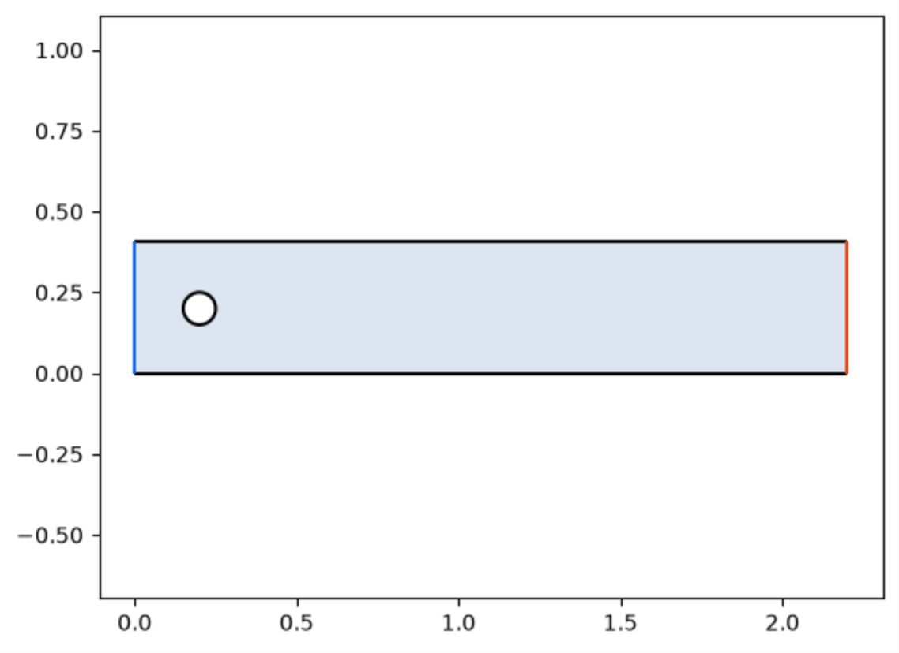<b>Marking edges</b>Marking tiny edges, open ends and chosen edges, and coloring by the edges' own colors.](marks.md)
[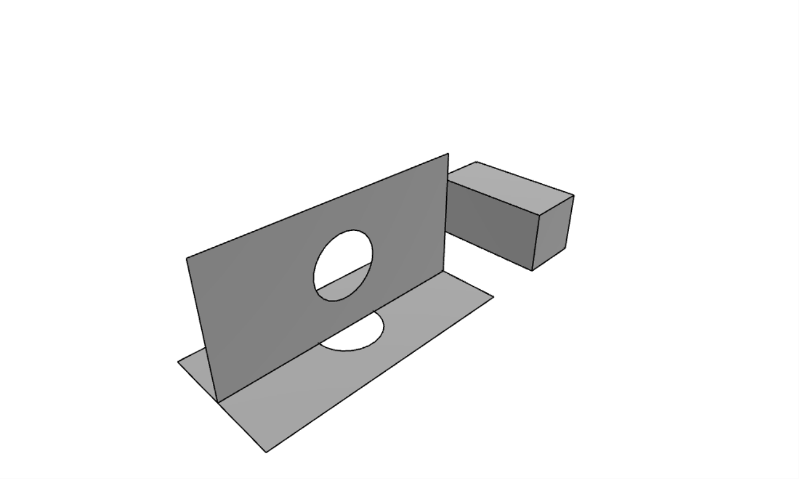<b>In 3D</b>Plot3d draws planex2d objects on their planes in 3D, together with OpenCASCADE shapes.](in-3d.md)

## Sketches

- [Sketch plots](sketches.md)

[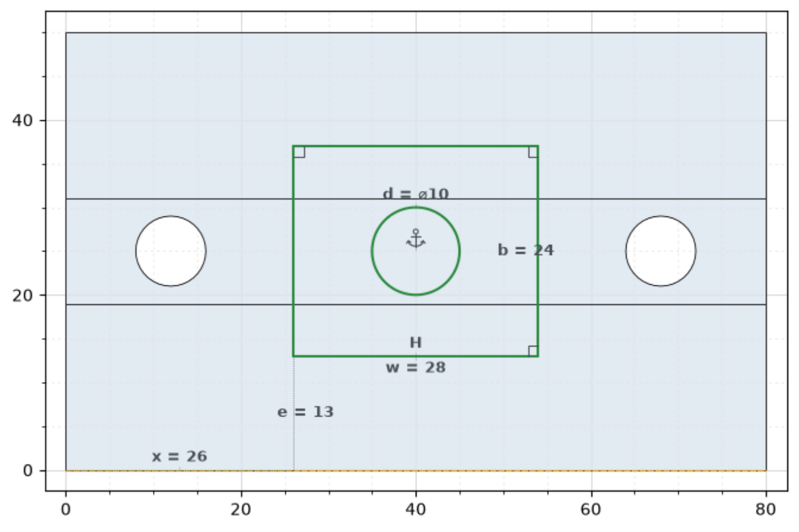<b>Sketch plots</b>Constraint states and signs, ends, directions, the solid below, and ids on hover.](sketches.md)

## Measurements and fields

- [Measurements](measurements.md)
- [Fields](fields.md)

[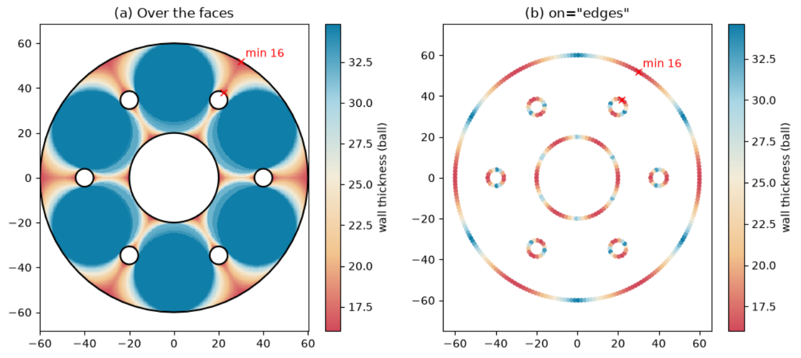<b>Measurements</b>Thickness maps over faces and edges, and drawing measurements of your own.](measurements.md)
[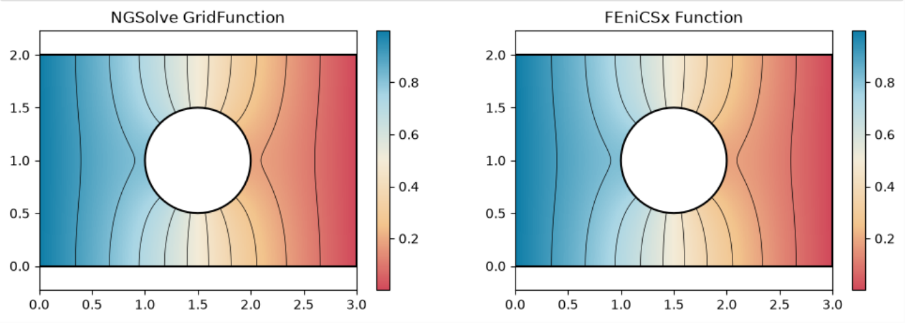<b>Fields</b>NGSolve and FEniCSx results drawn the same way, with contours, arrows and field lines.](fields.md)

## Everything at a glance

| `px.Plot` option | |
|---|---|
| `obj` | A face, shape, wire, compound, sketch or selection, an id that names one such as `"Sketch.1"`, or an OpenCASCADE shape. |
| `plane` | For an OpenCASCADE shape: the plane it is cut at (see [A section through a solid](matplotlib.md#A-section-through-a-solid)); without one, it is drawn flat in its own plane. |
| `ax` | A matplotlib Axes or plotly Figure to draw into; it also selects the backend. |
| `backend` | `"matplotlib"` (default) or `"plotly"`. |
| `line_col` | The color of every edge. `"type"` draws lines in black, arcs in `arc_col` and splines in `spline_col`, each with a legend entry; `"property"` uses each edge's own `col`. |
| `face_col` | The fill color of the faces (default `#dde6f0`); `None` draws the outlines only. |
| `mark_edges_smaller`, `mark_free_edges` | Marks short edges and edges with an open end at their midpoints. |
| `highlight` | Marks chosen edges, given as ids, selected edges or faces, indices or a mask. |
| `legend` | Shows the legend. |
| `show_constraints`, `show_ends`, `show_direction` | For a sketch: constraint signs, start and end pieces, and direction arrows. |
| `show_parent` | For a sketch: the OpenCASCADE solid it lies on, projected under it (see [On a solid](sketches.md#On-a-solid)). |

| Fields and meshes | |
|---|---|
| `px.PlotField(field, mesh, obj)` | Color maps of NGSolve and FEniCSx fields or of measurements, with the options `on`, `vectors`, `field_lines`, `contours`, `min`, `max`, `colormap` and `samples`. |
| `px.PlotMesh(mesh, obj)` | The element edges of a mesh, or of a cut through a 3D mesh. |

See [Fields](fields.md) and [Measurements](measurements.md) for drawing fields and measurements, and
[NGSolve](../../integrations/netgen/fields.md) and [FEniCSx](../../integrations/fenicsx.md) for the solvers.

Jupyter displays a plot by itself. In a script, `plt.show()` from `matplotlib.pyplot` opens the window.
