# Quick sketch

[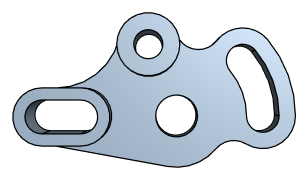<em class="px-tag">Example</em> A drafting exercise: projected, joined by tangents, extruded](../../examples/idler-plate.md)
[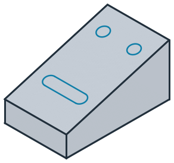A sketch on the slope of a solid](../../core/sketch/placement.md)
[A dovetail from parallels and angles](../../core/sketch/parallel-perpendicular-angle.md)

A sketch draws a profile from lines, arcs, circles and splines. An element can be placed by coordinates, but usually
it is placed by its relation to what is already drawn: a line ends where it meets an edge, runs parallel to another
line or at an angle to it, or touches a circle. planex2d computes the intersections and touch points, so none of them
has to be worked out by hand. A full circle is one exact edge, with no vertices on it.

Profile tools draw common shapes in one call: rectangles, slots, keyholes, polygons, fillets and chamfers.
Construction elements and points help to place the geometry without becoming part of the part. Every element gets an
id, so later calls can refer to it, and trimming, offsets, mirroring and patterns finish the drawing. The result is
wires, faces and shapes on any plane in 3D, ready for Boolean operations and export.

This section uses `px.QuickSketch`, which places every element once and keeps it as drawn, so it stays fast even for
thousands of elements. `px.Sketch` has the same drawing calls and adds constraints and dimensions, so the design
follows when a value changes. See [Constraint sketches](../constraints/index.md) for details.

In this section

## Drawing

- [Sketch or QuickSketch](quicksketch.md)
- [Lines and arcs](lines-and-arcs.md)
- [Circles and rectangles](circles-and-rectangles.md)
- [Slots, keyholes and polygons](slots-polygons.md)
- [Splines](splines.md)
- [Several loops](several-loops.md)

[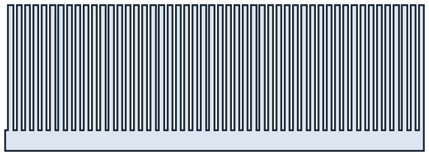<b>Sketch or QuickSketch</b>The same drawing calls with or without constraints, and what each costs.](quicksketch.md)
[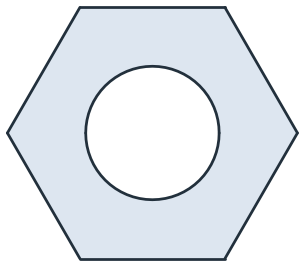<b>Lines and arcs</b>Lines by length, by offset or to a point, and arcs that continue the pen or leave along a direction.](lines-and-arcs.md)
[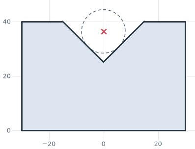<b>Circles and rectangles</b>Full circles and rectangles around the pen or a point, or placed by references, as for a pin touching a V-block.](circles-and-rectangles.md)
[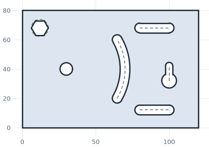<b>Slots, keyholes and polygons</b>Slots, arc slots, keyholes and hexagons in one call each, as on a motor mounting plate.](slots-polygons.md)
[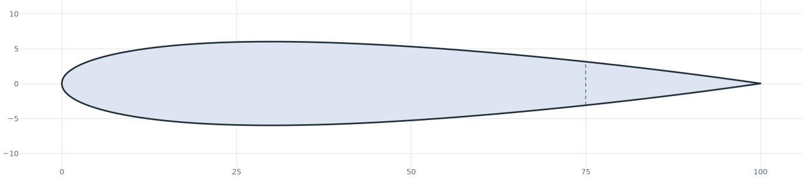<b>Splines</b>A spline through points, joined to lines and arcs, from an airfoil to a cam.](splines.md)
[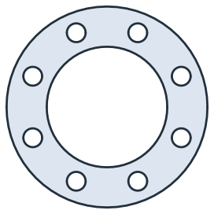<b>Several loops</b>Many loops in one sketch, with holes determined by nesting.](several-loops.md)

## References

- [To, from and until](until-from-to.md)
- [Parallel, perpendicular, angle](parallel-perpendicular-angle.md)
- [Tangents](tangent.md)
- [Arcs from references](arc-references.md)
- [Choosing between solutions](choosing.md)
- [Construction elements and points](construction.md)
- [Automatic ids](names.md)

[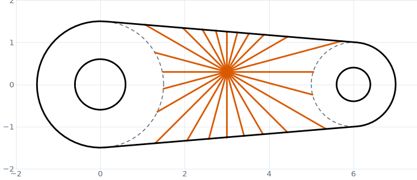<b>To, from and until</b>Lines that end on other edges, or on whichever edge comes first.](until-from-to.md)
[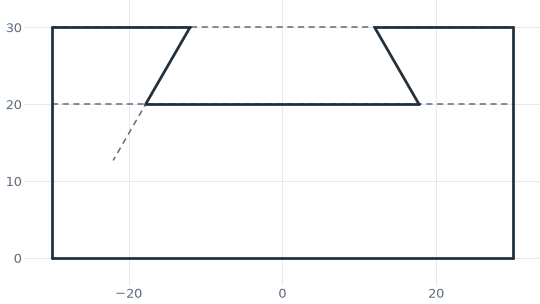<b>Parallel, perpendicular, angle</b>Directions taken from other edges, as in a dovetail slide.](parallel-perpendicular-angle.md)
[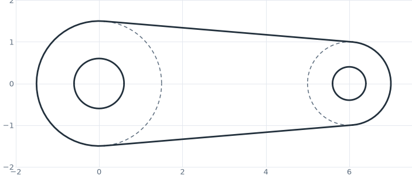<b>Tangents</b>Lines and arcs that touch circles and splines, as in a link between two bosses.](tangent.md)
[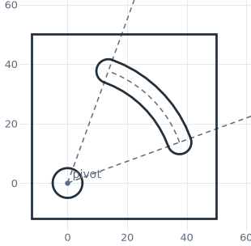<b>Arcs from references</b>Arcs on given circles and between given edges.](arc-references.md)
[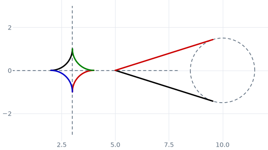<b>Choosing between solutions</b>Choosing between two tangents or fillets with reverse= or a point given with the target.](choosing.md)
[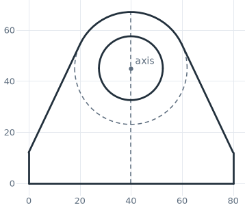<b>Construction elements and points</b>Elements and points that carry the design but stay out of the part.](construction.md)
[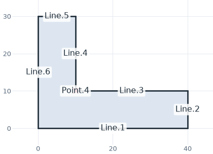<b>Automatic ids</b>Every element and point has an id, as in CAD sketchers.](names.md)

## Editing

- [Fillets and chamfers](fillets-chamfers.md)
- [Extending edges](extending.md)
- [Offsets](offsets.md)
- [Trimming and splitting](trimming.md)
- [Symmetry](symmetry.md)

[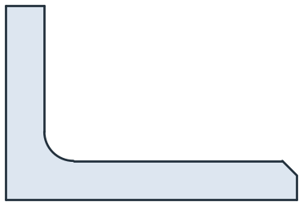<b>Fillets and chamfers</b>Rounded and cut corners on faces and in sketches, with the radius as a dimension.](fillets-chamfers.md)
[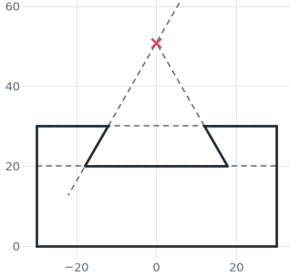<b>Extending edges</b>A line continued on the carrier of another line, up to a theoretical sharp.](extending.md)
[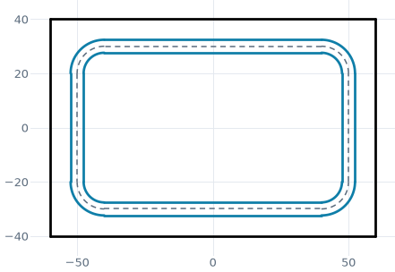<b>Offsets</b>Bands, loops and one-sided offsets of lines, arcs and splines, as in a seal groove.](offsets.md)
[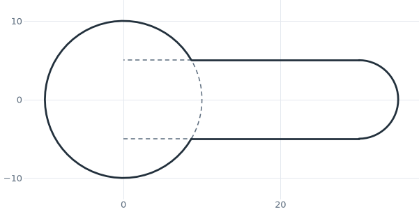<b>Trimming and splitting</b>Elements drawn past each other and cut back, as in a keyhole.](trimming.md)
[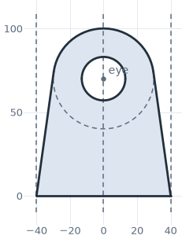<b>Symmetry</b>Half of a part drawn and mirrored, as in a lifting lug.](symmetry.md)

## Placement

- [Placing a sketch](placement.md)

[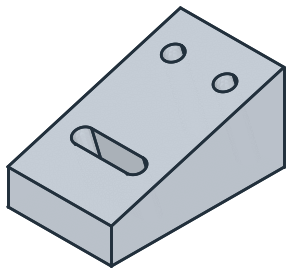<b>Placing a sketch</b>Sketching on a plane or a face of a solid, against its edges, and cutting the result back into it.](placement.md)

## Design

- [Parametric design](parametric.md)

[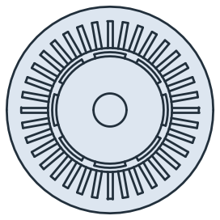<b>Parametric design</b>A motor lamination as a function of its slots and magnets.](parametric.md)

## Everything at a glance

| | |
|---|---|
| **Sketches** | `px.QuickSketch()` places every element once, without a solver; `px.Sketch()` takes the same calls and adds constraints and dimensions; `px.Move((h, v))` starts a QuickSketch at a point. |
| **Draw** | `Line`, `Arc`, `Spline`, `Circle`, `Rectangle`, `RectangleC`, `Slot`, `ArcSlot`, `Keyhole`, `Polygon`, `Hexagon`, `Close`, `Finish` |
| **Move the pen** | `Move((h, v))`, `Move(id)`, `Move(dh, dv)`, `Move(l)`, `Turn(angle)`, `Direction((dh, dv))` |
| **Lines** | `Line(l)`, `Line(dh, dv)`, `Line(to)`, `Line(from, to)`; helpers `until=`, `parallel=`, `distance=`, `perpendicular=`, `angle=`, `congruent=`, `tangent=`, `through=`, `reverse=` |
| **Arcs** | `Arc(r, sweep)`, `Arc(to)`, `Arc(to, r)`, `Arc(from, to, r)`; helpers `sweep=`, `center=`, `concentric=`, `congruent=`, `tangent=`, `through=`, `until=`, `reverse=` |
| **Circles** | `Circle(r)`, `Circle(h, v, r)`, `Circle(r, center=, concentric=, congruent=, through=, tangent=, reverse=)`. A full circle is one exact edge with no vertices. |
| **Rectangles** | `Rectangle(l, w)` from the pen, `Rectangle(p0, p1)` from two corners, `Rectangle(p0, p1, p2)` from a side and a point on the opposite side, `RectangleC(l, w)` around the pen or a center |
| **Ready-made shapes** | `Slot(l, w)`, `ArcSlot(r, sweep, w)`, `Keyhole(l, w, r)`, `Polygon(r, n)`, `Hexagon(af)`; see [Slots, keyholes and polygons](slots-polygons.md). |
| **Targets** | Ids, `px.H`, `px.V`, edges, wires, faces, OpenCASCADE shapes, or `(target, point)`, where the point decides that target's choice; `until=px.first` / `px.last`. |
| **Ids** | Automatic ids such as `Line.1`, `Arc.2`, `Point.3` and `Chain.1` for every element, point and chain, or your own with `id=`. `"id.start"`, `"id.end"`, `"id.mid"` and `"id.center"` refer to an element's points, `Chain.-1` counts from the end, and selections accept globs such as `"w.**.corner"`. |
| **Construction** | `construction=True`, `Vertex(id, point)`, `points`, `Location(id)`, `Edge(id)`, `Construction()` |
| **Offsets** | `Offset(source, d, both_sides=)`, or `(d, point)` for one side; the two sides are `.left` and `.right`. In a constraint sketch, `"<id>.d"` is its distance. |
| **Edit** | `Trim(a, b, reverse=)`, `Split(a, b)`, `Fillet(at, r)`, `Chamfer(at, d, d2=, angle=)` (see [Fillets and chamfers](fillets-chamfers.md)), `SymmetryLine(a, b)`, `Mirror(axis)`, `Mirrored(ids, axis)`, `LinearPattern(ids, dir, count, spacing)`, `CircularPattern(ids, center, count)`, `Remove(id)` |
| **Motions** | `Translate`, `Rotate`, `Scale`, `Mirror` and their copies `Translated`, `Rotated`, `Scaled`, `Mirrored`, on the whole sketch or, for `Mirror`, on chosen elements; see [Moving, rotating, mirroring, scaling](../basics/motions.md). |
| **3D geometry** | `Project(shape)`, `Intersect3d(shape)`; see [Projecting 3D geometry](../../integrations/occ/projecting.md). |
| **Properties** | `name`, `col`, `maxh`, `minh`, `hpref`, `layer` and `partition` on every drawing call; `id_wire=` on `Close` and `Finish`. |
| **Plane** | `px.QuickSketch(face)` on a face of a solid, with the global origin and x axis projected onto it; also a `px.Plane`, netgen axes or another planex2d object as the first argument, `copy=True` to take over its geometry. `px.Plane(face, origin=, axis=)` projects another origin or axis; `SetOrigin(point)`, `Copy()`. See [The plane in 3D](../basics/plane.md). |
| **Results** | `Wire()`, `Wires()`, `Face()`, `Shape()`, `Edge(id)` (a wire), `ToOCCShape()`, `Plot()` |
