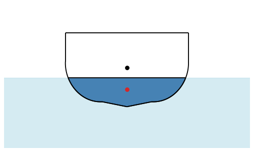

# Boat stability: the righting lever curve

The stability of a boat follows from its cross-section, and the example is a hull section heeled from upright to
capsized. When the hull heels and the waterline is found at which it
still displaces its weight, the center of buoyancy, the centroid of the part under water, moves sideways. The
horizontal distance between it and the center of gravity is the righting lever GZ. Plotted against the heel angle, it
shows how stiff the boat is and from which angle it capsizes. All of it is Boolean operations and centroids. Lengths
are in m, per meter of hull length.

{.result}

```python
import math
import matplotlib.pyplot as plt
from matplotlib.animation import FuncAnimation
from IPython.display import HTML
import planex as px
```

## The hull

The hull is a round-bilge section, 3 m wide and 1.8 m deep. Half of it is drawn, mirrored and united. Upright, it
floats at a `draft` of 0.7 m, and its center of gravity G lies `KG` = 0.95 m above the keel (Figure 1). `below` is
everything below a waterline, and the part of the hull under water is the hull times it.

```python
half = px.QuickSketch().Line((0.6, 0.12)).Spline([(1.2, 0.35), (1.45, 0.75), (1.5, 1.1)]).Line((1.5, 1.8))
half = half.Line((0, 1.8)).Close().Face()
hull = px.Unify([half, half.Mirrored((0, 0), (0, 1))]).faces[0]
draft = 0.7
KG = 0.95
G = (0.0, KG)


def below(level):
    return px.QuickSketch((-20, -20)).Rectangle(40, level + 20).Face()


displaced = (hull * below(draft)).mass
print("hull area", hull.mass, "m², under water", displaced, "m²")
```

```text
hull area 4.7623728074753 m², under water 1.4780596282012237 m²
```

```python
Row((hull, "The hull upright, the part under water and G", {"fills": [(hull * below(draft), LIGHT)], "dots": [G]}),
    caption="A round-bilge hull section")
```

```text
<IPython.core.display.HTML object>
```

## Heeled

The hull turns about its center of gravity, and the waterline then rises or falls until the part under water has
the upright area again, which bisection finds. GZ is how far the center of buoyancy lies beside the center of
gravity, positive when it rights the boat. The center of buoyancy B is the centroid of the part under water, its
`center`.

```python
def heeled(angle):
    body = hull.Rotated(G, -angle)
    low, high = -3.0, 4.0
    for step in range(50):
        level = (low + high) / 2
        if (body * below(level)).mass < displaced:
            low = level
        else:
            high = level
    wet = body * below(level)
    B = wet.center[:2]
    return {"angle": angle, "body": body, "level": level, "wet": wet, "B": B, "GZ": B[0] - G[0]}


curve = [heeled(angle) for angle in range(0, 181, 3)]
best = max(curve, key=lambda s: s["GZ"])
vanishing = next((s["angle"] for s in curve[1:] if s["GZ"] < 0), None)
print("largest righting lever", round(best["GZ"], 3), "m at", best["angle"], "degrees")
print("it rights itself up to", vanishing, "degrees")
```

```text
largest righting lever 0.424 m at 48 degrees
it rights itself up to 99 degrees
```

## Check: the metacentric height

For small angles, GZ = GM sin φ. GM is the height of the metacenter above G, KB + BM − KG, where KB is the height of
the upright center of buoyancy and BM = I / V, with I the second moment of the waterline (its width cubed over 12 per
meter of length) and V the area under water. **Check:** GZ at a heel of 1° agrees with GM sin 1°:

```python
upright = hull * below(draft)
KB = upright.center[1]
crossings = sorted(v.x for v in hull.Intersections(px.Line((-5, draft), (5, draft))))
width = crossings[-1] - crossings[0]
BM = width**3 / 12 / displaced
GM = KB + BM - KG
print("waterline", round(width, 4), "m wide, KB", round(KB, 4), "m, BM", round(BM, 4), "m, GM", round(GM, 4), "m")
print("GZ at 1 degree", round(heeled(1.0)["GZ"], 5), "m, GM sin 1 degree", round(GM * math.sin(math.radians(1)), 5), "m")
```

```text
waterline 2.8637 m wide, KB 0.4164 m, BM 1.3241 m, GM 0.7905 m
GZ at 1 degree 0.01379 m, GM sin 1 degree 0.0138 m
```

The righting lever curve starts with the slope GM per radian (Figure 2):

```python
Chart("heel [°]", "righting lever GZ [m]", curves={"GZ": ([s["angle"] for s in curve], [s["GZ"] for s in curve])},
      lines={"slope GM at the start": ([0, 57.3], [0, GM])}, title="The righting lever curve")
```

```text
<IPython.core.display.HTML object>
```

## Heeling over

The hull heeling to 90° and back, with G in black and B in red:

```python
fig, ax = plt.subplots(figsize=(7, 5))
frames = curve[:31] + curve[:31][::-1]


def frame(k):
    s = frames[k]
    ax.clear()
    ax.fill([-4, 4, 4, -4], [-1, -1, s["level"], s["level"]], color="lightblue", alpha=0.5)
    s["body"].Plot(ax=ax, face_col="white", legend=False)
    s["wet"].Plot(ax=ax, face_col="steelblue", legend=False)
    ax.plot(*G, "o", color="black")
    ax.plot(*s["B"], "o", color="tab:red")
    ax.plot([G[0], s["B"][0]], [G[1], G[1]], color="tab:red", lw=2)
    ax.set_xlim(-3, 3)
    ax.set_ylim(-1, 2.5)
    ax.set_aspect("equal", adjustable="box")
    ax.set_title(f"Heel {s['angle']}°, GZ = {s['GZ']:.3f} m")


animation = FuncAnimation(fig, frame, frames=len(frames), interval=80)
plt.close(fig)
HTML(animation.to_jshtml())
```

```text
<IPython.core.display.HTML object>
```
