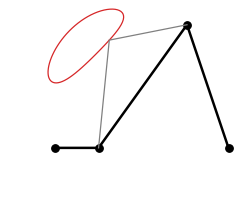
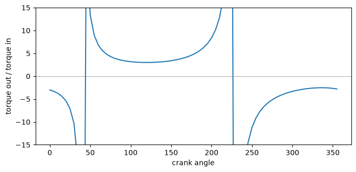

# Four-bar linkage and its coupler curve

The example is a crank-rocker four-bar linkage with a ground `d` = 4, a crank `a` = 1, a coupler `b` = 3.5 and a
rocker `c` = 3. For every crank angle, the linkage is a small sketch. The crank goes to its end, the coupler goes from
there to the point where it meets the rocker's circle, and the rocker goes back to its pivot. An arm of 2.5 at 30° to
the coupler carries the coupler point. Its path, the coupler curve, comes out of 72 sketches, with no constraint
solver involved.

{.result}

```python
import math
import matplotlib.pyplot as plt
from matplotlib.animation import FuncAnimation
from IPython.display import HTML
import planex as px
```

**Check:** the lengths meet Grashof's condition for a crank-rocker, with the crank shortest, so the crank turns all the
way round:

```python
d = 4.0
a = 1.0
b = 3.5
c = 3.0
print("crank-rocker", a + d <= b + c and a < min(b, c, d))
```

```text
crank-rocker True
```

## One position

The coupler ends where the circle of its length around the crank end meets the circle of the rocker's length around
its pivot. Of the two intersections, the upper one is the intended assembly. The arm leaves the crank end at 30° to the
coupler (Figure 1).

```python
def position(theta):
    B = (a * math.cos(math.radians(theta)), a * math.sin(math.radians(theta)))
    C = max(px.Circle(B, b).Intersections(px.Circle((d, 0), c)), key=lambda p: p.y)
    s = px.QuickSketch()
    s.Line(B, id="crank").Line((C.x, C.y), id="coupler").Line((d, 0), id="rocker")
    s.Move(B).Line(2.5, angle=(30, "coupler"), id="arm")
    return s, B, (C.x, C.y), s.pen.position


sketch, B, C, P = position(60)
```

```python
Row((sketch, "Crank, coupler, rocker and the arm at 60°", {"fill": False}), caption="One position of the linkage")
```

```text
<IPython.core.display.HTML object>
```

## Check

**Check:** the rocker angle agrees with Freudenstein's equation, solved in closed form, over a full turn of the crank
in steps of 5°:

```python
def freudenstein(theta):
    t = math.radians(theta)
    K1 = d / a
    K2 = d / c
    K3 = (a**2 - b**2 + c**2 + d**2) / (2 * a * c)
    A = math.cos(t) - K1 - K2 * math.cos(t) + K3
    B = -2 * math.sin(t)
    C = K1 - (K2 + 1) * math.cos(t) + K3
    return [2 * math.degrees(math.atan((-B + sign * math.sqrt(B**2 - 4 * A * C)) / (2 * A))) for sign in (1, -1)]


thetas = list(range(0, 360, 5))
positions = [position(theta) for theta in thetas]
rocker_angles = [math.degrees(math.atan2(C[1], C[0] - d)) for s, B, C, P in positions]
worst = max(min(abs((phi - f + 180) % 360 - 180) for f in freudenstein(theta))
            for theta, phi in zip(thetas, rocker_angles))
print("largest difference of the rocker angle", worst, "degrees")
```

```text
largest difference of the rocker angle 2.842170943040401e-14 degrees
```

## In motion

The animation shows the linkage through all 72 positions, with the coupler curve.

```python
fig, ax = plt.subplots(figsize=(7, 5))
curve = [P for s, B, C, P in positions] + [positions[0][3]]
ax.plot([p[0] for p in curve], [p[1] for p in curve], color="tab:red", lw=1)
links, = ax.plot([], [], "o-", color="black", lw=2)
plate, = ax.plot([], [], "-", color="gray", lw=1)
ax.set_aspect("equal")
ax.set_xlim(-2, 6)
ax.set_ylim(-2, 6)


def frame(k):
    s, B, C, P = positions[k]
    links.set_data([0, B[0], C[0], d], [0, B[1], C[1], 0])
    plate.set_data([B[0], P[0], C[0]], [B[1], P[1], C[1]])
    return links, plate


animation = FuncAnimation(fig, frame, frames=len(positions), interval=60)
plt.close(fig)
HTML(animation.to_jshtml())
```

```text
<IPython.core.display.HTML object>
```

## Torque out over torque in

Without losses, the power going in at the crank comes out at the rocker. The torque ratio is therefore the inverse
ratio of the angular speeds, dθ/dφ, here taken from the sketched rocker angles. It grows without bound where the
rocker reverses, at the toggle positions, where a small torque on the crank holds a large one on the rocker. The
change of the rocker angle over two steps of the crank, 10°, gives the ratio:

```python
ratio = []
for k in range(len(thetas)):
    dphi = (rocker_angles[(k + 1) % len(thetas)] - rocker_angles[k - 1] + 180) % 360 - 180
    ratio.append(10 / dphi if abs(dphi) > 1e-9 else float("inf"))
```

The torque ratio over a turn of the crank:

```python
fig, ax = plt.subplots(figsize=(8, 3.5))
ax.plot(thetas, ratio)
ax.set_ylim(-15, 15)
ax.axhline(0, color="gray", lw=0.5)
ax.set_xlabel("crank angle")
ax.set_ylabel("torque out / torque in")
plt.show()
```


