# Examples

These examples show complete parts, from the sketch to the solid, the mesh and a simulation. Every example is a real
part or a classic problem with its own numbers, and each checks its result against a formula, a textbook value or a
measured property.

## Machines and vehicles

- [Toy plane](toy-plane.md)
- [Model rocket](rocket.md)
- [Rear wing with DRS](rear-wing.md)
- [Suspension kinematics](suspension-kinematics.md)
- [Excavator arm](excavator-arm.md)
- [Spur gears under load](spur-gears.md)
- [Planetary gearbox](planetary-gearbox.md)
- [Wankel engine](wankel-engine.md)
- [Idler plate](idler-plate.md)

[<b>Toy plane</b>Fuselage frames, NACA wings and engines, lofted and revolved.](toy-plane.md)
[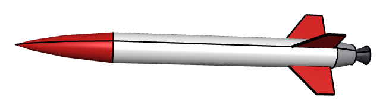<b>Model rocket</b>A von Kármán nose cone as a spline, revolved, with swept fins.](rocket.md)
[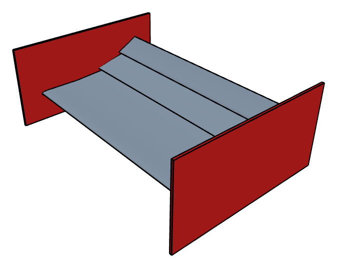<b>Rear wing with DRS</b>A three-element Formula Student wing, in 3D and meshed in 2D.](rear-wing.md)
[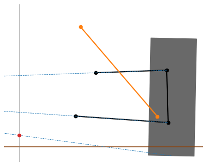<b>Suspension kinematics</b>Double wishbones in bump and rebound, with their instant and roll centers.](suspension-kinematics.md)
[<b>Excavator arm</b>A 20 t arm as one constraint sketch, with its working range and a trench.](excavator-arm.md)
[<b>Spur gears under load</b>Involute flanks as splines, meshed and loaded, with the von Mises stress.](spur-gears.md)
[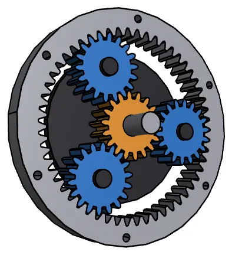<b>Planetary gearbox</b>Sun, three planets and ring gear, 15 mm wide, with backlash.](planetary-gearbox.md)
[<b>Wankel engine</b>Epitrochoid housing, a rotor that fits in every position, three chambers.](wankel-engine.md)
[<b>Idler plate</b>A classic drafting exercise, projected, joined by tangents and extruded.](idler-plate.md)

## Mechanisms

- [Four-bar linkage](four-bar-linkage.md)
- [Hood hinge](hood-hinge.md)
- [Jansen linkage](jansen-linkage.md)
- [Straight-line linkages](straight-line-linkages.md)
- [Geneva drive](geneva-drive.md)
- [Cycloidal drive](cycloidal-drive.md)
- [Belt drives](belt-drives.md)
- [Drilling a square hole](square-hole.md)

[<b>Four-bar linkage</b>A crank-rocker and its coupler curve through 72 positions.](four-bar-linkage.md)
[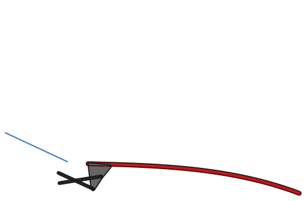<b>Hood hinge</b>Three-position synthesis in a constraint sketch, checked against the textbook.](hood-hinge.md)
[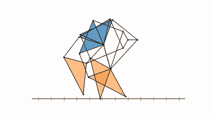<b>Jansen linkage</b>The Strandbeest leg with eleven links on one crank and the foot&#x27;s flat step.](jansen-linkage.md)
[<b>Straight-line linkages</b>Watt, Chebyshev and the exact Peaucellier-Lipkin linkage.](straight-line-linkages.md)
[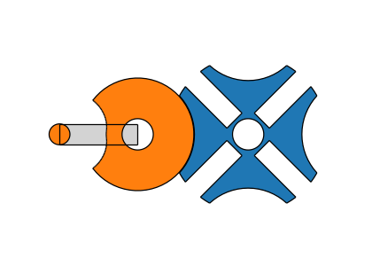<b>Geneva drive</b>A quarter turn per revolution, with the locking disc cut by what the wheel sweeps.](geneva-drive.md)
[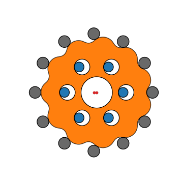<b>Cycloidal drive</b>The disc cut by every ring pin at every crank angle.](cycloidal-drive.md)
[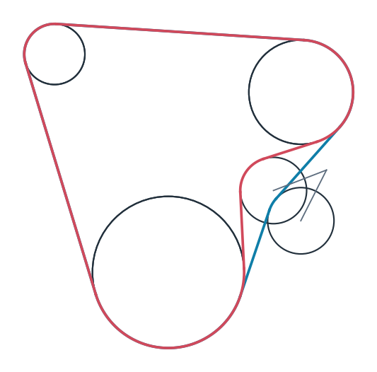<b>Belt drives</b>The belt length as one expression, with the pulley and tensioner placed by the solver.](belt-drives.md)
[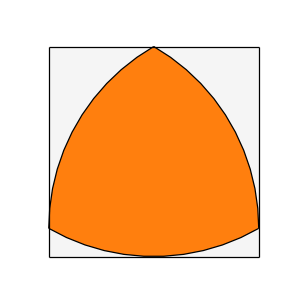<b>Drilling a square hole</b>A Reuleaux triangle covers exactly 98.77 % of the square.](square-hole.md)

## Physics

- [Isospectral drums](isospectral-drums.md)
- [Boat stability](boat-stability.md)
- [Flow through sand](flow-through-sand.md)
- [Solar shading](solar-shading.md)

[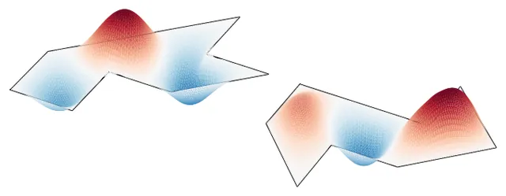<b>Isospectral drums</b>Two drums with the same eigenvalues, so the shape cannot be heard.](isospectral-drums.md)
[<b>Boat stability</b>The waterline at constant displacement and the righting lever curve.](boat-stability.md)
[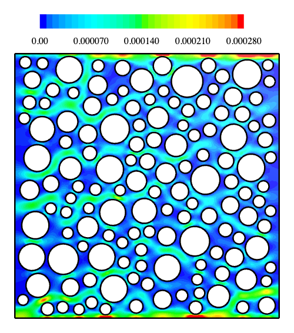<b>Flow through sand</b>Stokes flow through packed grains against the Kozeny-Carman law.](flow-through-sand.md)
[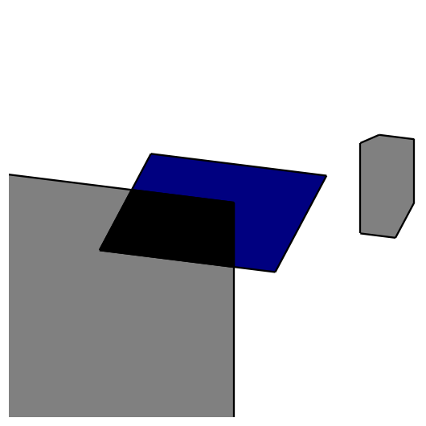<b>Solar shading</b>The shaded share of a roof panel, hour by hour, through the year.](solar-shading.md)

## Fields and simulation

- [Surface magnet motor](motor.md)
- [Heat sink](heat-sink.md)
- [Hilbert heater](hilbert-heater.md)
- [Parallelogram flexure](parallelogram-flexure.md)
- [Vivaldi antenna](vivaldi-antenna.md)
- [Patch antenna](patch-antenna.md)
- [Voronoi bone](voronoi-bone.md)
- [Lens ray tracing](lens-ray-tracing.md)
- [Airplane windows](airplane-windows.md)

[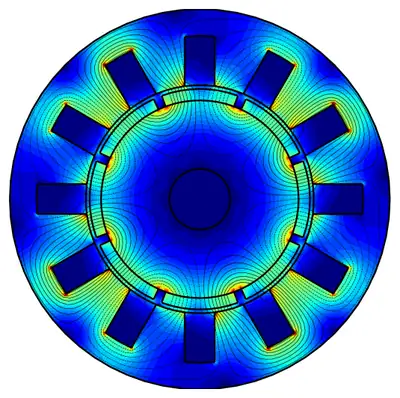<b>Surface magnet motor</b>A lamination glued into regions, its field, and a 12-slot design under load.](motor.md)
[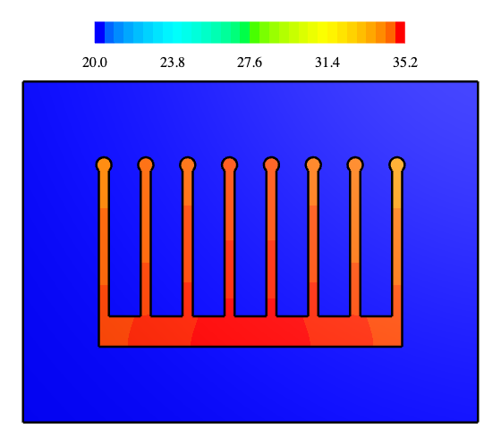<b>Heat sink</b>Conduction and convection in an extruded profile, one fin against fin theory.](heat-sink.md)
[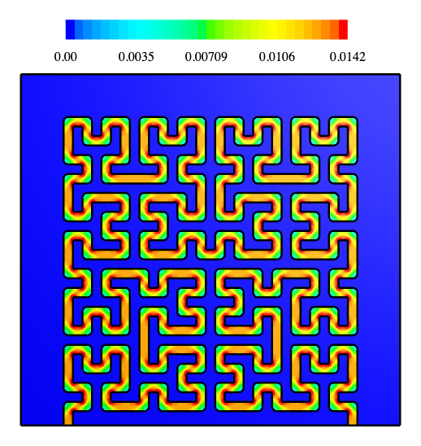<b>Hilbert heater</b>A heater track along a Hilbert curve, with current, Joule heat and temperature.](hilbert-heater.md)
[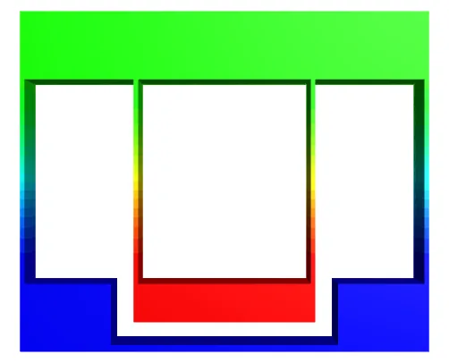<b>Parallelogram flexure</b>A flexure stage from one block, pushed sideways in a 3D elasticity solve.](parallelogram-flexure.md)
[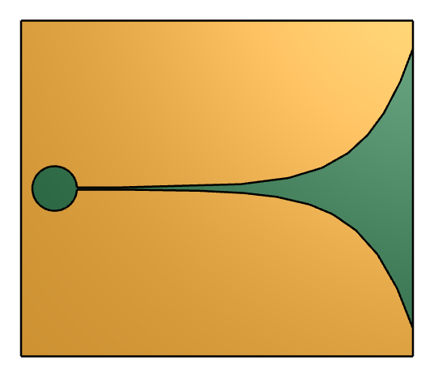<b>Vivaldi antenna</b>An exponential tapered slot with a round cavity and a radial stub.](vivaldi-antenna.md)
[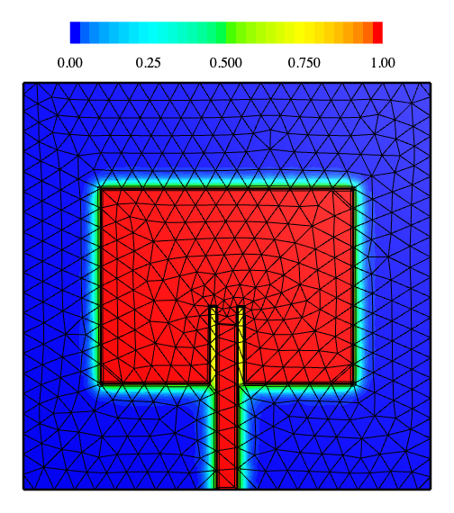<b>Patch antenna</b>A 2.45 GHz inset-fed patch from the design formulas, and its potential.](patch-antenna.md)
[<b>Voronoi bone</b>Some 6000 struts united at once, pressed against a scaling law.](voronoi-bone.md)
[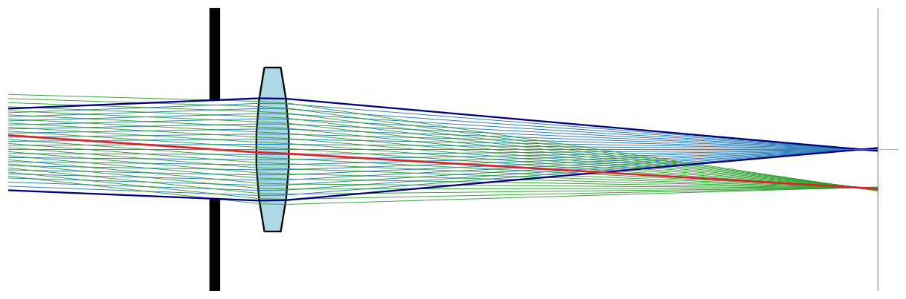<b>Lens ray tracing</b>A biconvex lens as two intersected discs, with Snell&#x27;s law and chief and marginal rays.](lens-ray-tracing.md)
[<b>Airplane windows</b>Round, oval and square windows in a pressurized skin, against Kirsch, Inglis and Williams.](airplane-windows.md)

## Manufacturing

- [Gear cutting](gear-cutting.md)
- [Pocket milling](pocket-milling.md)
- [A slicer for 3D printing](slicer.md)
- [Laser-cut box](laser-cut-box.md)
- [Stencil lettering](stencil-lettering.md)

[<b>Gear cutting</b>A rack cutter with one subtraction per position, from which involutes and undercut emerge.](gear-cutting.md)
[<b>Pocket milling</b>Offsets for a 6 mm end mill and the material left in the corners.](pocket-milling.md)
[<b>A slicer for 3D printing</b>A STEP part cut into layers, with perimeters, infill and G-code.](slicer.md)
[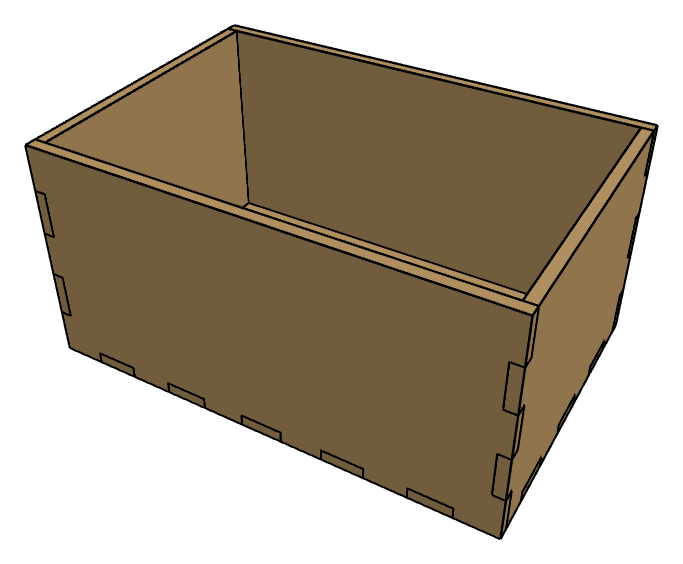<b>Laser-cut box</b>Finger joints with the kerf compensated by offsets, and the cut path as DXF.](laser-cut-box.md)
[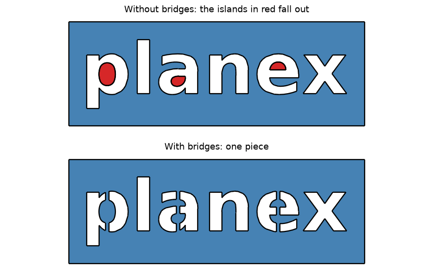<b>Stencil lettering</b>Islands inside letters found and bridged so that nothing falls out.](stencil-lettering.md)

## Geometry and design

- [Penrose tiling](penrose-tiling.md)
- [Rose window](rose-window.md)
- [Path planning](path-planning.md)
- [The moving sofa](moving-sofa.md)
- [Prince Rupert's cube](prince-ruperts-cube.md)
- [The coastline paradox](coastline-paradox.md)
- [Drawing a logo](drawing-a-logo.md)

[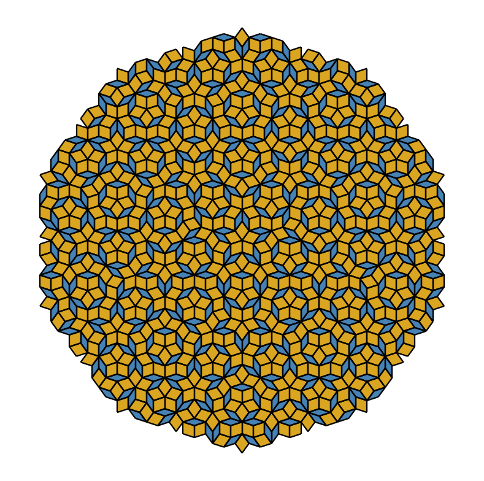<b>Penrose tiling</b>Golden triangles deflated, with the area kept exactly and the thick-to-thin ratio tending to φ.](penrose-tiling.md)
[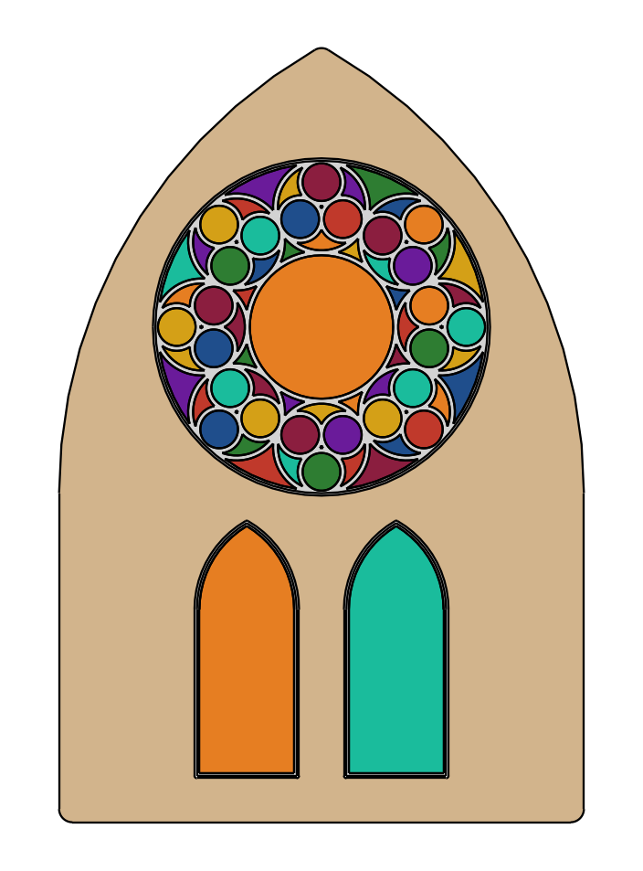<b>Rose window</b>Gothic tracery from circles that touch circles, bars as offsets.](rose-window.md)
[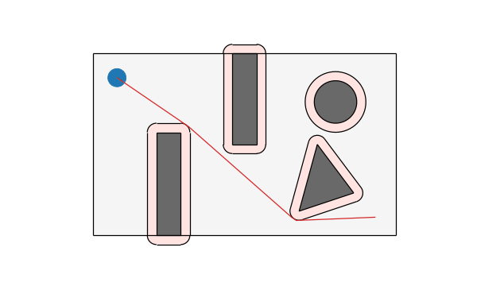<b>Path planning</b>Obstacles grown by offsets, and the shortest path through a visibility graph.](path-planning.md)
[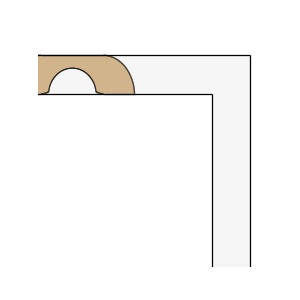<b>The moving sofa</b>The largest sofa around a corner as one intersection, Hammersley&#x27;s exactly and Gerver&#x27;s within 0.0001.](moving-sofa.md)
[<b>Prince Rupert&#x27;s cube</b>A cube through a hole in a cube of its size, the largest one 3√2/4 to twelve digits.](prince-ruperts-cube.md)
[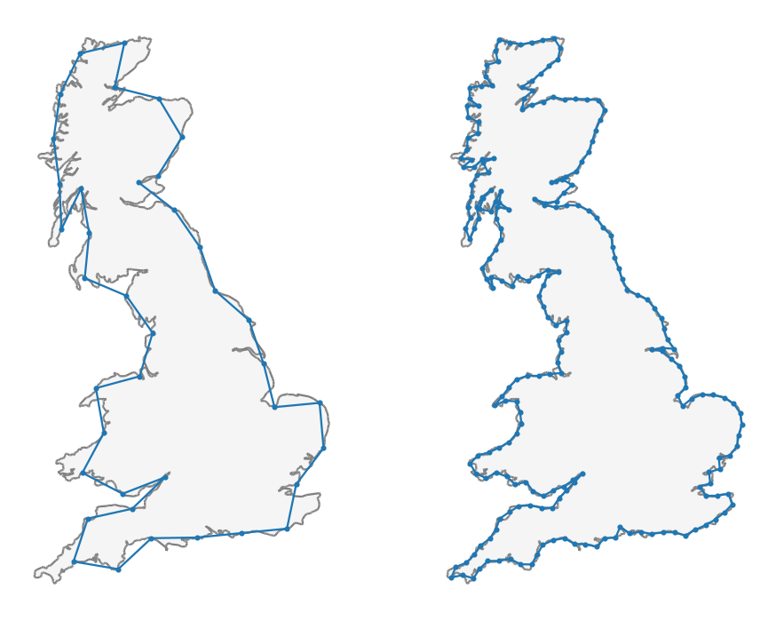<b>The coastline paradox</b>Richardson&#x27;s dividers on the Koch snowflake and on the coast of Great Britain.](coastline-paradox.md)
[<b>Drawing a logo</b>The planex2d mark from its own SVG: Bézier curves as exact B-splines, a Reuleaux triangle of constant width.](drawing-a-logo.md)
