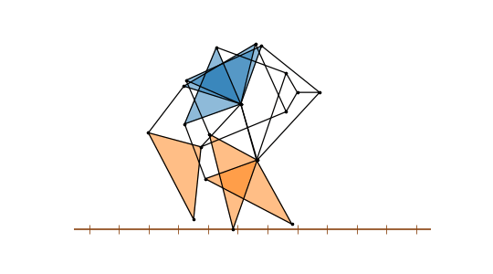

# Jansen linkage: the Strandbeest leg

The example is the leg of Theo Jansen's Strandbeest, the wind-driven beach walker. It has eleven links on one crank,
with the lengths that Jansen found by evolving them in a computer, his "holy numbers". For every crank angle, each joint
sits where two circles meet, one around each joint it is linked to, so a position is a chain of circle intersections.
The foot runs along a path with a nearly flat bottom, and that part is the step on the ground.

{.result}

```python
import math
import matplotlib.pyplot as plt
from matplotlib.animation import FuncAnimation
from IPython.display import HTML
import planex as px
```

## The holy numbers

The crank pin Z turns around the axle O, and Y is the fixed pivot on the frame, at (−38, −7.8) from the axle. Jansen
names the lengths with letters:

| Link | Jansen's letter | Length |
|---|---|---|
| O–Z, the crank | m | 15 |
| Z–X | j | 50 |
| Y–X | b | 41.5 |
| Z–W | k | 61.9 |
| Y–W | c | 39.3 |
| Y–V | d | 40.1 |
| X–V | e | 55.8 |
| V–U | f | 39.4 |
| W–U | g | 36.7 |
| U–T | h | 65.7 |
| W–T | i | 49 |

The offsets of Y are his a = 38 and l = 7.8.

```python
Y = (-38, -7.8)
links = {("O", "Z"): 15, ("Z", "X"): 50, ("Y", "X"): 41.5, ("Z", "W"): 61.9, ("Y", "W"): 39.3, ("Y", "V"): 40.1,
         ("X", "V"): 55.8, ("V", "U"): 39.4, ("W", "U"): 36.7, ("U", "T"): 65.7, ("W", "T"): 49}
```

## One position

The upper rocker joint X and the lower one W hang between the crank pin and Y, the rigid triangle Y-X-V and the knee
U follow, and the foot T is the tip of the rigid triangle W-U-T. Of the two intersections of each pair of circles, one
is the leg as built (Figure 1).

```python
def meet(p, r, q, s):
    return [(v.x, v.y) for v in px.Circle(p, r).Intersections(px.Circle(q, s))]


def leg(theta):
    t = math.radians(theta)
    Z = (15 * math.cos(t), 15 * math.sin(t))
    X = max(meet(Z, links["Z", "X"], Y, links["Y", "X"]), key=lambda p: p[1])
    W = min(meet(Z, links["Z", "W"], Y, links["Y", "W"]), key=lambda p: p[1])
    V = min(meet(Y, links["Y", "V"], X, links["X", "V"]), key=lambda p: p[0])
    U = min(meet(V, links["V", "U"], W, links["W", "U"]), key=lambda p: p[0])
    T = min(meet(W, links["W", "T"], U, links["U", "T"]), key=lambda p: p[1])
    return {"O": (0, 0), "Y": Y, "Z": Z, "X": X, "W": W, "V": V, "U": U, "T": T}


def sketch(joints):
    s = px.QuickSketch()
    for p, q in links:
        s.Move(joints[p]).Line(joints[q], id=p + q)
    return s
```

```python
Row((sketch(leg(30)), "The leg with the crank at 30°", {"fill": False}), caption="One position of the Jansen leg")
```

```text
<IPython.core.display.HTML object>
```

**Check:** every link keeps its length in all 72 positions of a crank turn:

```python
angles = list(range(0, 360, 5))
legs = [leg(theta) for theta in angles]
worst = max(abs(math.dist(joints[p], joints[q]) - length) for joints in legs for (p, q), length in links.items())
print("largest change of a link length", worst)
```

```text
largest change of a link length 4.263256414560601e-14
```

## The foot

The foot is on the ground while it is close to its lowest point. There, it moves backwards relative to the frame at
a nearly steady speed, which pushes the walker forward. The step is the length of that flat stretch, and the lift is
how high the foot rises in between. Here, the foot counts as on the ground while it is less than 1 above its lowest
point (the dots in Figure 2).

```python
foot = [joints["T"] for joints in legs]
low = min(y for x, y in foot)
ground = [n for n, (x, y) in enumerate(foot) if y < low + 1.0]
stride = max(foot[n][0] for n in ground) - min(foot[n][0] for n in ground)
print("on the ground for", len(ground), "of", len(foot), "positions")
print("step", round(stride, 1), "lift", round(max(y for x, y in foot) - low, 1))
```

```text
on the ground for 31 of 72 positions
step 56.1 lift 22.3
```

```python
Row((px.FromPolyline(foot, closed=True), "The foot's path", {"fill": False, "dots": [foot[n] for n in ground]}),
    caption="The path of the foot over a crank turn, on the ground at the dots")
```

```text
<IPython.core.display.HTML object>
```

## Walking

Three legs sit on one crank, a third of a turn apart, so one is always on the ground. The frame moves forward at the
speed at which the grounded foot moves back, so a foot that touches the ground stays where it is until it lifts. How
far it still slips shows how flat the step is.

```python
first = next(n for n in ground if (n - 1) % len(foot) not in ground)
stance = sorted(ground, key=lambda n: (n - first) % len(foot))
turned = [5 * ((n - first) % len(foot)) for n in stance]
ground_speed = (foot[stance[-1]][0] - foot[stance[0]][0]) / (turned[-1] - turned[0])
slid = [foot[n][0] - ground_speed * t for n, t in zip(stance, turned)]
print("a grounded foot slips by", round(max(slid) - min(slid), 2), "over a step of", round(stride, 1))
```

```text
a grounded foot slips by 2.86 over a step of 56.1
```

Three legs walking, a third of a crank turn apart:

```python
phases = (0, 120, 240)
fig, ax = plt.subplots(figsize=(9, 5))
ax.axhline(low, color="saddlebrown", lw=2)
ax.plot(list(range(-800, 800, 20)), [low] * 80, "|", color="saddlebrown", ms=12)
lines = [ax.plot([], [], "o-", color="black", lw=1.5, ms=3)[0] for _ in phases]
uppers = [ax.fill([0], [0], color="tab:blue", alpha=0.5)[0] for _ in phases]
lowers = [ax.fill([0], [0], color="tab:orange", alpha=0.5)[0] for _ in phases]
ax.set_aspect("equal")
ax.set_ylim(low - 10, 40)
ax.axis("off")


def frame(n):
    theta = 5 * n
    shift = -ground_speed * theta
    for phase, line, upper, lower in zip(phases, lines, uppers, lowers):
        J = {key: (x + shift, y) for key, (x, y) in leg(theta + phase).items()}
        xs, ys = [], []
        for u, w in links:
            xs += [J[u][0], J[w][0], None]
            ys += [J[u][1], J[w][1], None]
        line.set_data(xs, ys)
        upper.set_xy([J["Y"], J["X"], J["V"]])
        lower.set_xy([J["W"], J["U"], J["T"]])
    ax.set_xlim(-150 + shift, 90 + shift)
    return lines + uppers + lowers


animation = FuncAnimation(fig, frame, frames=144, interval=50)
plt.close(fig)
HTML(animation.to_jshtml())
```

```text
<IPython.core.display.HTML object>
```
