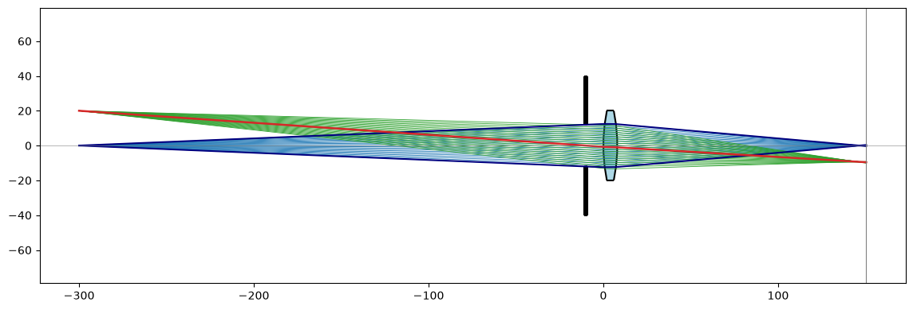
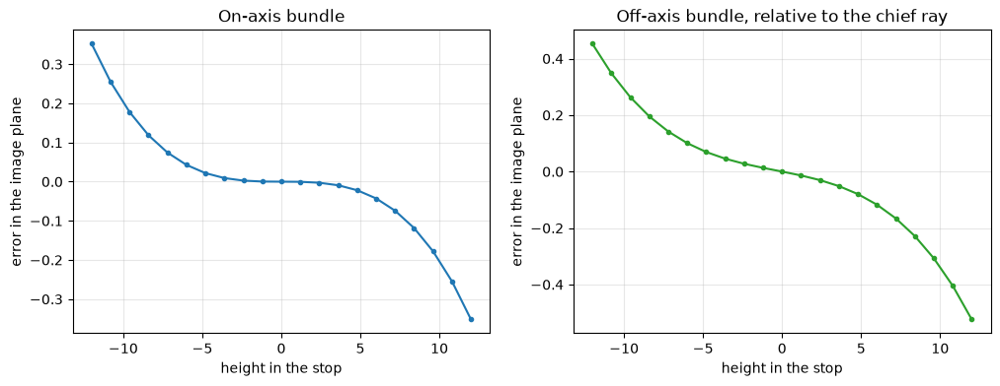

# Ray tracing through a biconvex lens

The example is a biconvex lens of N-BK7 glass, the intersection of two discs. Rays are traced through it by finding
where they meet its surfaces and bending them by Snell's law. An aperture stop in front of the lens limits the light.
The chief ray goes from an off-axis object point through the stop's center, the marginal rays from the on-axis point
to the stop's edge, and the bundles fill the stop. Lengths are in mm.

{.result}

```python
import math
import matplotlib.pyplot as plt
import planex as px
```

## The lens

The lens has radii `R1` = 100 and `R2` = −100, a `thickness` of 8, a diameter of 40 and the index `n_glass` = 1.5168.
The two discs are centered at `C1` and `C2`, and a rectangle of the lens's diameter cuts off its rim (Figure 1).

```python
n_glass = 1.5168
R1 = 100.0
R2 = -100.0
thickness = 8.0
C1 = (R1, 0.0)
C2 = (thickness + R2, 0.0)
front = px.QuickSketch().Circle(C1[0], C1[1], abs(R1)).Face()
back = px.QuickSketch().Circle(C2[0], C2[1], abs(R2)).Face()
rim = px.QuickSketch((-5, -20)).Rectangle(thickness + 10, 40).Face()
lens = (front * back * rim).faces[0]
print("lens area", round(lens.mass, 3))
```

```text
lens area 266.342
```

```python
Row((lens, "The lens"), caption="A biconvex lens as the intersection of two discs and a rectangle")
```

```text
<IPython.core.display.HTML object>
```

The thick-lens formula gives the focal length and the principal planes:

```python
power = (n_glass - 1) * (1 / R1 - 1 / R2 + (n_glass - 1) * thickness / (n_glass * R1 * R2))
f = 1 / power
H1 = -f * (n_glass - 1) * thickness / (n_glass * R2)
H2 = thickness - f * (n_glass - 1) * thickness / (n_glass * R1)
print("focal length", round(f, 4), "principal planes at x =", round(H1, 4), "and", round(H2, 4))
```

```text
focal length 98.086 principal planes at x = 2.6736 and 5.3264
```

## Tracing

A ray is a long line from its start, and the lens's first intersection with it is where it enters. The surface
normal there points from the surface's center. Snell's law in vector form gives the new direction, and the next
intersection along it is where the ray leaves.

```python
def unit(v):
    length = math.hypot(*v)
    return (v[0] / length, v[1] / length)


def refract(d, normal, n1, n2):
    cos_i = -(d[0] * normal[0] + d[1] * normal[1])
    eta = n1 / n2
    cos_t = math.sqrt(1 - eta**2 * (1 - cos_i**2))
    return unit((eta * d[0] + (eta * cos_i - cos_t) * normal[0], eta * d[1] + (eta * cos_i - cos_t) * normal[1]))


def beam(start, d):
    return px.Line((start[0] + 1e-6 * d[0], start[1] + 1e-6 * d[1]), (start[0] + 1000 * d[0], start[1] + 1000 * d[1]))


def first_hit(start, d):
    hits = [(v.x, v.y) for v in lens.Intersections(beam(start, d))]
    return min(hits, key=lambda q: math.dist(q, start)) if hits else None


def trace(start, direction, end_x):
    d = unit(direction)
    entry = first_hit(start, d)
    if entry is None or abs(math.dist(entry, C1) - abs(R1)) > 1e-6:
        return None
    d = refract(d, unit((entry[0] - C1[0], entry[1] - C1[1])), 1.0, n_glass)
    leave = first_hit(entry, d)
    if leave is None or abs(math.dist(leave, C2) - abs(R2)) > 1e-6:
        return None
    d = refract(d, unit((C2[0] - leave[0], C2[1] - leave[1])), n_glass, 1.0)
    t = (end_x - leave[0]) / d[0]
    return [start, entry, leave, (leave[0] + t * d[0], leave[1] + t * d[1])], d


def crosses_axis(path):
    (x0, y0), (x1, y1) = path[-2], path[-1]
    return x0 - y0 * (x1 - x0) / (y1 - y0)
```

## Check

**Check:** a ray close and parallel to the axis, 0.01 above it, crosses the axis at the back focal point, f behind the
second principal plane, and its height over its final slope is the focal length.

```python
path, d = trace((-50, 0.01), (1, 0), 200)
print("back focal point traced", round(crosses_axis(path), 6), "thick-lens formula", round(H2 + f, 6))
print("focal length from the ray", round(-0.01 / (d[1] / d[0]), 6), "formula", round(f, 6))
```

```text
back focal point traced 103.41244 thick-lens formula 103.412442
focal length from the ray 98.086009 formula 98.08601
```

## Chief ray, marginal rays and bundles

The object lies 300 in front of the lens, at `object_x`, with an on-axis point and one at a `height` of 20 off the axis.
The stop of radius `stop_r` = 12 sits at `stop_x`, 10 in front of the lens. The paraxial image plane follows from the
principal planes.

```python
object_x = -300.0
height = 20.0
stop_x = -10.0
stop_r = 12.0
s_object = H1 - object_x
s_image = 1 / (1 / f - 1 / s_object)
image_x = H2 + s_image
print("image plane at x =", round(image_x, 4), "magnification", round(-s_image / s_object, 4))
```

```text
image plane at x = 150.4381 magnification -0.4794
```

`through_stop` traces a ray from an object point through a height in the stop. The bundles pass the stop at 21
heights each:

```python
def through_stop(point, y_stop):
    return trace(point, (stop_x - point[0], y_stop - point[1]), image_x)


stop = px.QuickSketch((stop_x - 1, -40)).Rectangle(2, 80).Face()
stop = stop - px.QuickSketch((stop_x - 2, -stop_r)).Rectangle(4, 2 * stop_r).Face()
heights = [stop_r * (k / 10) for k in range(-10, 11)]
on_axis = [through_stop((object_x, 0.0), y) for y in heights]
off_axis = [through_stop((object_x, height), y) for y in heights]
chief = through_stop((object_x, height), 0.0)
```

**Check:** the chief ray lands close to the paraxial image height, off by the lens's distortion:

```python
print("chief ray lands at", round(chief[0][-1][1], 4), "paraxial image height", round(-height * s_image / s_object, 4))
```

```text
chief ray lands at -9.5791 paraxial image height -9.5887
```

The rays through the lens: the on-axis bundle in blue with its marginal rays dark, the off-axis bundle in green and
the chief ray in red.

```python
rays, ax = plt.subplots(figsize=(14, 4.5))
lens.Plot(ax=ax, face_col="lightblue", legend=False)
stop.Plot(ax=ax, face_col="black", legend=False)
for traced, color in ((on_axis, "tab:blue"), (off_axis, "tab:green")):
    for ray in traced:
        if ray:
            ax.plot(*zip(*ray[0]), color=color, lw=0.6)
for ray in (on_axis[0], on_axis[-1]):
    ax.plot(*zip(*ray[0]), color="navy", lw=1.5)
ax.plot(*zip(*chief[0]), color="tab:red", lw=1.8)
ax.axvline(image_x, color="gray", lw=0.8)
ax.axhline(0, color="gray", lw=0.4)
ax.set_aspect("equal")
plt.show()
```



## Aberrations

The ray fan plots where each ray of a bundle lands in the image plane against where it passed the stop. The S-shape
of the on-axis fan is spherical aberration, and the curve of the off-axis fan is coma.

```python
fig, (left, right) = plt.subplots(1, 2, figsize=(12, 4))
left.plot(heights, [ray[0][-1][1] for ray in on_axis], "o-", ms=3)
left.set_title("On-axis bundle")
right.plot(heights, [ray[0][-1][1] - chief[0][-1][1] for ray in off_axis], "o-", ms=3, color="tab:green")
right.set_title("Off-axis bundle, relative to the chief ray")
for ax in (left, right):
    ax.set_xlabel("height in the stop")
    ax.set_ylabel("error in the image plane")
    ax.grid(alpha=0.3)
plt.show()
```



## Which way round

Finally, a plano-convex lens of the same focal length sits in a parallel beam. With the curved side towards the beam,
both surfaces share the bending, and the marginal rays focus much closer to the paraxial focus than with the flat side
first. The lens is 6 thick, with the diameter of 40.

```python
def plano_convex(flipped, focal=100.0, t=6.0, D=40.0):
    R = focal * (n_glass - 1)
    center = (R if not flipped else t - R, 0.0)
    curved = px.QuickSketch().Circle(center[0], 0, R).Face()
    slab = px.QuickSketch((0, -D / 2)).Rectangle(t, D).Face()
    return (curved * slab).faces[0], center, R


def trace_any(face, center, R, y, end_x=300.0):
    d, start, points = (1.0, 0.0), (-50.0, y), [(-50.0, y)]
    for step in range(2):
        hit = min(((v.x, v.y) for v in face.Intersections(beam(start, d))), key=lambda q: math.dist(q, start))
        on_curve = abs(math.dist(hit, center) - R) < 1e-6
        normal = unit((hit[0] - center[0], hit[1] - center[1])) if on_curve else (-1.0, 0.0)
        if normal[0] * d[0] + normal[1] * d[1] > 0:
            normal = (-normal[0], -normal[1])
        d = refract(d, normal, 1.0 if step == 0 else n_glass, n_glass if step == 0 else 1.0)
        points.append(hit)
        start = hit
    t = (end_x - start[0]) / d[0]
    points.append((start[0] + t * d[0], start[1] + t * d[1]))
    return points


for flipped, label in ((False, "curved side to the beam"), (True, "flat side to the beam")):
    face, center, R = plano_convex(flipped)
    focus = [crosses_axis(trace_any(face, center, R, y)) for y in (0.05, 15.0)]
    print(label, "paraxial focus", round(focus[0], 3), "rays at 15 focus", round(focus[0] - focus[1], 3), "shorter")
```

```text
curved side to the beam paraxial focus 102.044 rays at 15 focus 2.505 shorter
flat side to the beam paraxial focus 106.0 rays at 15 focus 10.09 shorter
```
