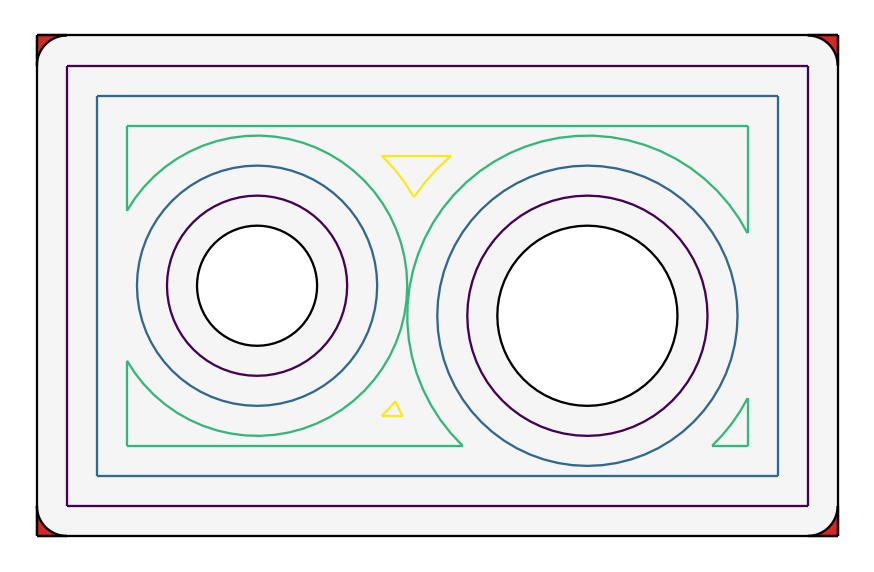
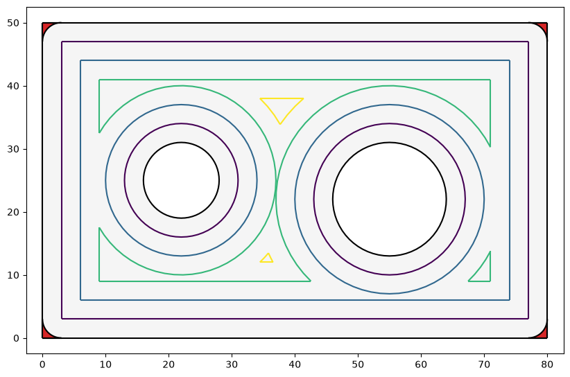

# Pocket milling toolpaths

The example is a CNC pocket of 80 × 50 with two round bosses left standing in it, cleared with a 6 mm end mill. The
tool's center runs along offsets of the pocket's outline, the first at the tool's radius from the walls and each
following one a stepover further in, until nothing is left. What the tool cannot reach remains, which is exactly r² (1 −
π/4) in each sharp corner of the pocket.

{.result}

```python
import math
import matplotlib.pyplot as plt
import planex as px
```

The pocket is one sketch, with the bosses of radius 6 and 9 as holes:

```python
pocket = px.QuickSketch().Rectangle(80, 50).Circle(22, 25, 6).Circle(55, 22, 9).Face()
print("pocket area", round(pocket.mass, 3), len(pocket.inner), "bosses")
```

```text
pocket area 3632.434 2 bosses
```

## Toolpaths

After k passes, the tool's center may go anywhere in the pocket offset inward by d = r + k times the stepover: the
rectangle shrunk by d, minus the bosses grown by d. The tool's radius is `r` = 3, and the stepover is 3 too. The outline
of each region is a toolpath, until the offset leaves nothing.

```python
r = 3.0
passes = []
while True:
    area = pocket.Offset(-(r + len(passes) * 3.0), inplace=False)
    if area.mass < 1e-9:
        break
    passes.append([w for face in area.faces for w in (face.outer, *face.inner)])
length = sum(w.mass for paths in passes for w in paths)
print(len(passes), "passes,", sum(len(p) for p in passes), "loops,", round(length, 1), "mm of toolpath")
print(round(length / 1200, 2), "min at a feed of 1200 mm/min")
```

```text
4 passes, 10 loops, 1051.8 mm of toolpath
0.88 min at a feed of 1200 mm/min
```

## What is left

The tool sweeps a band of its radius around every toolpath, which is the path's offset. With the stepover no larger
than the radius, the bands overlap, so only the four corners of the pocket remain. **Check:** what is left is
4 r² (1 − π/4) in total, in four pieces:

```python
swept = px.Unify([w.Offset(r) for paths in passes for w in paths])
rest = pocket - swept
print("left in the pocket", rest.mass, "mm², four corners 4 r² (1 - π/4)", 4 * r**2 * (1 - math.pi / 4), "mm²")
print(len(rest.faces), "pieces")
```

```text
left in the pocket 7.725666117691862 mm², four corners 4 r² (1 - π/4) 7.725666117691862 mm²
4 pieces
```

The toolpaths, colored from the first pass to the last, and what is left in red:

```python
fig, ax = plt.subplots(figsize=(10, 6.5))
pocket.Plot(ax=ax, face_col="whitesmoke", legend=False)
colors = [tuple(c) for c in plt.cm.viridis([k / max(1, len(passes) - 1) for k in range(len(passes))])]
for paths, color in zip(passes, colors):
    for w in paths:
        w.Plot(ax=ax, line_col=color, arc_col=color, spline_col=color, legend=False)
rest.Plot(ax=ax, face_col="tab:red", legend=False)
ax.set_aspect("equal")
plt.show()
```


