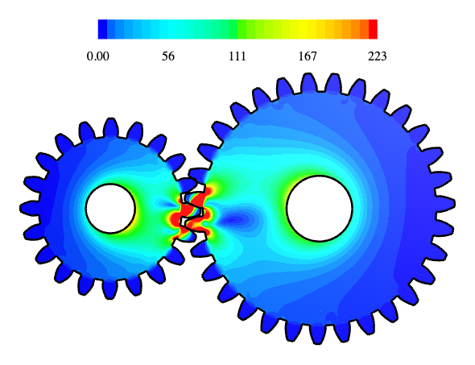

# Involute spur gears under load

The example is a pair of involute spur gears with a module of `m` = 2, a pressure angle of `alpha` = 20° and no
profile shift: a pinion with 20 teeth and a wheel with 31. The flanks are involutes of the base circle, computed point
by point and drawn as splines. Below the base circle, the flanks run radially, without a root fillet. Lengths are in
mm.

{.result}

```python
import math
import netgen.occ as occ
import ngsolve as ngs
from ngsolve.webgui import Draw
import planex as px
```

## A gear

One tooth is a sketch from the center out along one flank, over the tip and back down the other, and the teeth are
united with the root circle. `gear(z)` draws a gear with z teeth, from the pitch radius m z / 2, the base radius, the
tip radius one module above it and the root radius 1.25 modules below it (Figure 1).

```python
m = 2.0
alpha = math.radians(20)


def inv(a):
    return math.tan(a) - a


def gear(z):
    r = m * z / 2
    rb, ra, rf = r * math.cos(alpha), r + m, r - 1.25 * m
    beta = math.pi / (2 * z) + inv(alpha)
    ta = math.sqrt((ra / rb) ** 2 - 1)
    flank = []
    for i in range(21):
        t = ta * i / 20
        rt, phi = rb * math.sqrt(1 + t * t), -(beta - inv(math.atan(t)))
        flank.append((rt * math.cos(phi), rt * math.sin(phi)))
    other = [(x, -y) for x, y in flank]
    tip = 2 * math.degrees(beta - inv(math.atan(ta)))
    tooth = px.QuickSketch().Line(flank[0]).Spline(flank[1:]).Arc(center=(0, 0), sweep=tip)
    tooth = tooth.Spline(other[::-1][1:]).Close().Face()
    teeth = [tooth.Rotated((0, 0), 360 * k / z) for k in range(z)]
    return px.Unify(teeth + [px.QuickSketch().Circle(rf).Face()])


z = 20
wheel = gear(z)
```

```python
Row((wheel, "The pinion, 20 teeth"), caption="An involute spur gear of module 2")
```

```text
<IPython.core.display.HTML object>
```

**Check:** the pitch circle, split by the gear, runs inside the teeth over a tooth thickness of π m / 2 each:

```python
pitch = px.QuickSketch().Circle(m * z / 2).Wire()
inside = []
for run in pitch.Split(wheel):
    p = run.wires[0].edges[0].midpoint
    if wheel.Contains((p.h, p.v), boundary=False):
        inside.append(run.wires[0].mass)
print(len(inside), "teeth, thickness", sum(inside) / z, "exact", math.pi * m / 2)
```

```text
20 teeth, thickness 3.141592567868958 exact 3.141592653589793
```

## A pair

The wheel with 31 teeth sits at the center distance m (z1 + z2) / 2, turned by half a pitch so that a tooth gap faces
the pinion tooth on the line of centers (Figure 2). The two touch but do not overlap:

```python
z2 = 31
center = m * (z + z2) / 2
partner = gear(z2).Rotated((0, 0), 180 + 180 / z2).Translated((center, 0))
print("overlap", (wheel * partner).mass)
```

```text
overlap 0.0
```

```python
Row((px.Compound([wheel, partner]), "Pinion and wheel at the center distance"), caption="The gear pair")
```

```text
<IPython.core.display.HTML object>
```

## Teeth under load

The pinion is held at its bore of 12, and the wheel is turned by 0.002 rad at its bore of 16. Turned by another 0.2°,
the wheel's teeth overlap the pinion's slightly where they touch. Gluing the two gears joins them over that overlap,
so the load passes from tooth to tooth.

```python
pinion = wheel - px.QuickSketch().Circle(6, name="hold").Face()
driven = gear(z2).Rotated((0, 0), 180 + 180 / z2 + 0.2).Translated((center, 0))
driven = driven - px.QuickSketch().Circle(center, 0, 8, name="drive").Face()
pinion.name = "pinion"
driven.name = "wheel"
pair = px.Glue([pinion, driven])
mesh = ngs.Mesh(px.OCCGeometry(pair).GenerateMesh(maxh=0.5))
mesh.Curve(3)
```

```text
<ngsolve.comp.Mesh at 0x7fadbd205550>
```

NGSolve solves for plane stress in steel, with a Young's modulus `E` of 210 000 N/mm² and a Poisson's ratio `nu` of
0.3. The picture shows the von Mises stress on the deformation, magnified 20 times. Its colour scale ends at 30 % of
the largest element mean of the stress.

```python
E = 210000.0
nu = 0.3
fes = ngs.VectorH1(mesh, order=2, dirichlet="hold|drive")
u, v = fes.TnT()

def strain(w):
    return ngs.Sym(ngs.Grad(w))

def stress(w):
    e = strain(w)
    return E / (1 - nu**2) * ((1 - nu) * e + nu * ngs.Trace(e) * ngs.Id(2))

a = ngs.BilinearForm(ngs.InnerProduct(stress(u), strain(v)) * ngs.dx).Assemble()
disp = ngs.GridFunction(fes)
disp.Set(ngs.CF((-0.002 * ngs.y, 0.002 * (ngs.x - center))), definedon=mesh.Boundaries("drive"))
disp.vec.data += a.mat.Inverse(fes.FreeDofs(), inverse="sparsecholesky") * (-a.mat * disp.vec)
s = stress(disp)
mises = ngs.sqrt(s[0, 0] ** 2 + s[1, 1] ** 2 - s[0, 0] * s[1, 1] + 3 * s[0, 1] ** 2)
peak = ngs.GridFunction(ngs.L2(mesh, order=0))
peak.Set(mises)
Draw(mises, mesh, deformation=20 * disp, min=0, max=0.3 * max(peak.vec))
```

*[interactive 3D view (netgen webgui); see the html page]*

## The part

For the 3D part, a bore of 12 with a keyway 4 wide and 1.8 deep into the hub is added, and the gear is extruded to a
width of 10.

```python
bore = px.QuickSketch().Circle(6).Face() + px.QuickSketch((-2, 0), dir=(1, 0)).Rectangle(4, 6 + 1.8).Face()
solid = (wheel - bore).ToOCCShape().Extrude(10)
solid.WriteStep("spur_gear.step")
Draw(solid)
```

*[interactive 3D view (netgen webgui); see the html page]*

The gear as STEP: [spur_gear.step](spur_gear.step)
