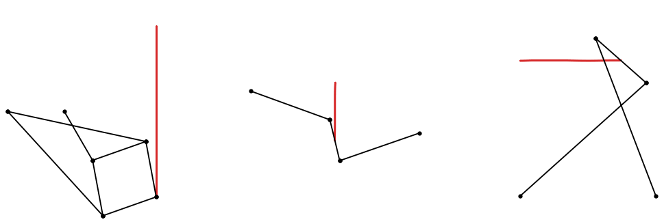

# Straight-line linkages: Watt, Chebyshev, Peaucellier-Lipkin

Before precise guideways, a straight motion had to come from links and pins. The example is three linkages that make
one: Watt's linkage and Chebyshev's give a nearly straight line, and in 1864, Peaucellier and Lipkin found a linkage
whose point moves on an exactly straight line. Every position is a chain of circle intersections, and the deviation
from the straight line is measured.

{.result}

```python
import math
import matplotlib.pyplot as plt
from matplotlib.animation import FuncAnimation
from IPython.display import HTML
import planex as px
```

`meet` gives the points where two circles meet, a circle of radius r around p and one of radius s around q:

```python
def meet(p, r, q, s):
    return [(v.x, v.y) for v in px.Circle(p, r).Intersections(px.Circle(q, s))]
```

## Peaucellier-Lipkin

In the Peaucellier-Lipkin linkage, two long arms L from the fixed pivot O hold a rhombus of side s at its corners A
and B. The rhombus's corner C is driven on a circle through O, and the opposite corner P lies at the distance
(L² − s²) / OC from O on the same ray. This is an inversion, which turns the circle through O into a straight line at
x = (L² − s²) / (2 r). Here, the driving circle has a radius `r` = 2, the arms are `L` = 5 long and the rhombus has
sides of `s` = 2 (Figure 1).

```python
r = 2.0
L = 5.0
s = 2.0
bars = [("Q", "C"), ("O", "A"), ("O", "B"), ("A", "C"), ("B", "C"), ("A", "P"), ("B", "P")]


def peaucellier(angle):
    t = math.radians(angle)
    C = (r * (1 + math.cos(t)), r * math.sin(t))
    A, B = meet((0, 0), L, C, s)
    P = max(meet(A, s, B, s), key=lambda q: q[0])
    return {"O": (0, 0), "Q": (r, 0), "C": C, "A": A, "B": B, "P": P}


cell = peaucellier(40)
sketch = px.QuickSketch()
for u, w in bars:
    sketch.Move(cell[u]).Line(cell[w], id=u + w)
```

```python
Row((sketch, "The linkage with the crank at 40°", {"fill": False}), caption="The Peaucellier-Lipkin linkage")
```

```text
<IPython.core.display.HTML object>
```

## Watt and Chebyshev

Two linkages give a nearly straight line from four bars:

- Watt's linkage has two equal bars of 2 pointing at each other from two pivots, joined by a coupler of 1 whose middle
  moves nearly straight;
- Chebyshev's linkage has two crossed bars of 2.5 on a base of 2, joined by a coupler of 1, whose middle also moves
  nearly straight.

```python
def watt(angle, bar=2.0, coupler=1.0):
    t = math.radians(angle)
    left = (-bar, coupler / 2)
    right = (bar, -coupler / 2)
    A = (left[0] + bar * math.cos(t), left[1] + bar * math.sin(t))
    B = min(meet(right, bar, A, coupler), key=lambda q: q[0])
    return {"left": left, "right": right, "A": A, "B": B, "P": ((A[0] + B[0]) / 2, (A[1] + B[1]) / 2)}


def chebyshev(angle):
    t = math.radians(angle)
    A = (2.5 * math.cos(t), 2.5 * math.sin(t))
    B = min(meet((2.0, 0.0), 2.5, A, 1.0), key=lambda q: q[0])
    return {"left": (0.0, 0.0), "right": (2.0, 0.0), "A": A, "B": B, "P": ((A[0] + B[0]) / 2, (A[1] + B[1]) / 2)}
```

## How straight

For each linkage, over a comparable stroke of its point, the deviation is how far the point strays across the stroke
from where it started. The Peaucellier-Lipkin linkage and Watt's move along y, Chebyshev's along x.

```python
def deviation(points, across):
    return max(abs(q[across] - points[0][across]) for q in points)


strokes = {
    "Peaucellier-Lipkin": ([peaucellier(angle)["P"] for angle in range(-60, 61, 2)], 0),
    "Watt": ([watt(angle)["P"] for angle in range(-20, 21)], 0),
    "Chebyshev": ([chebyshev(angle)["P"] for angle in range(42, 91)], 1),
}
for name, (points, across) in strokes.items():
    length = max(q[1 - across] for q in points) - min(q[1 - across] for q in points)
    print(name, "stroke", round(length, 3), "deviation", deviation(points, across))
```

```text
Peaucellier-Lipkin stroke 6.062 deviation 7.105427357601002e-15
Watt stroke 1.371 deviation 0.010938477390811704
Chebyshev stroke 1.484 deviation 0.004401804672808485
```

**Check:** the Peaucellier-Lipkin linkage's line lies at x = (L² − s²) / (2 r):

```python
print("Peaucellier line at x", strokes["Peaucellier-Lipkin"][0][0][0], "formula", (L**2 - s**2) / (2 * r))
```

```text
Peaucellier line at x 5.25 formula 5.25
```

## In motion

The three linkages, with the paths of their points:

```python
fig, axes = plt.subplots(1, 3, figsize=(15, 5))
setups = [("Peaucellier-Lipkin", peaucellier, list(range(-60, 61, 4)) + list(range(60, -61, -4)), bars),
          ("Watt", watt, list(range(-20, 21)) + list(range(20, -21, -1)),
           [("left", "A"), ("A", "B"), ("right", "B")]),
          ("Chebyshev", chebyshev, list(range(42, 91, 2)) + list(range(90, 41, -2)),
           [("left", "A"), ("A", "B"), ("right", "B")])]
drawn = []
for ax, (name, linkage, angles, bars) in zip(axes, setups):
    path = [linkage(angle)["P"] for angle in angles]
    ax.plot([q[0] for q in path], [q[1] for q in path], color="tab:red", lw=2)
    drawn.append(ax.plot([], [], "o-", color="black", lw=1.5, ms=4)[0])
    every = [linkage(angle) for angle in angles]
    xs = [q[0] for joints in every for q in joints.values()]
    ys = [q[1] for joints in every for q in joints.values()]
    ax.set_xlim(min(xs) - 0.5, max(xs) + 0.5)
    ax.set_ylim(min(ys) - 0.5, max(ys) + 0.5)
    ax.set_aspect("equal")
    ax.set_title(name)


def frame(n):
    for line, (name, linkage, angles, bars) in zip(drawn, setups):
        joints = linkage(angles[n % len(angles)])
        xs, ys = [], []
        for u, w in bars:
            xs += [joints[u][0], joints[w][0], None]
            ys += [joints[u][1], joints[w][1], None]
        line.set_data(xs, ys)
    return drawn


animation = FuncAnimation(fig, frame, frames=60, interval=80)
plt.close(fig)
HTML(animation.to_jshtml())
```

```text
<IPython.core.display.HTML object>
```
