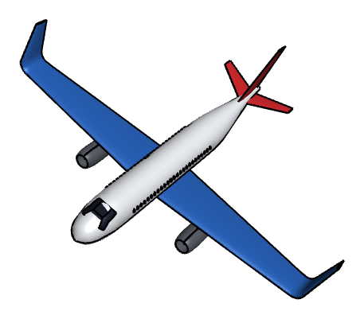
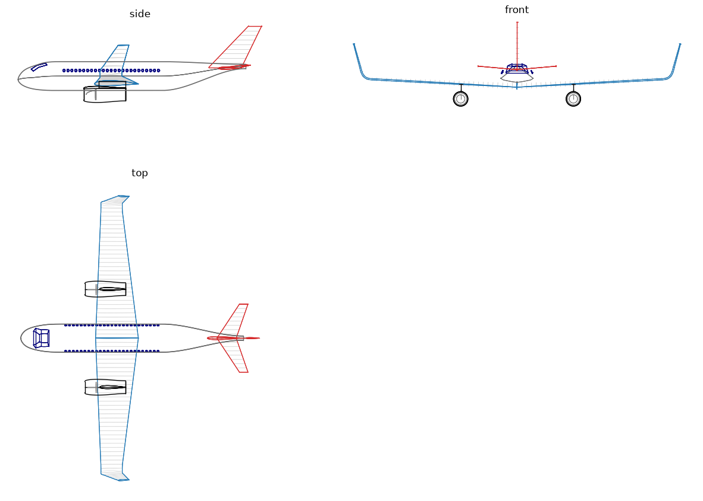

# Toy plane: lofted fuselage, wings and engines

The example is a toy airliner, 520 long, with a span of 667 over its winglet tips. Every part starts as planex2d
geometry on a construction plane: the fuselage frames and the nose profile, the NACA sections of the wing and the
tail, the half sections of the engines. OpenCASCADE lofts, revolves and extrudes them into solids. Lengths are in cm,
with the nose at the origin, x pointing aft and z up.

{.result}

```python
import math
import matplotlib.pyplot as plt
import netgen.occ as occ
from ngsolve_webgpu.jupyter import Draw
import planex as px
```

## Construction planes

The planes the parts are drawn on:

- `side` is the plane of symmetry, with h pointing aft and v up;
- the fuselage frames lie on `px.YZ`, moved aft with `Offset`;
- the wing and tail sections lie on `side`, turned about the x axis to the local slope of the span line and moved to
  their station;
- the pylons lie on `px.XY`.

The left half is the right half mirrored about `side`.

```python
side = px.Plane(normal=(0, -1, 0), axis=(1, 0, 0))


def section_plane(leading_edge, phi):
    return side.Rotated((0, 0, 0), (1, 0, 0), phi).Translated(leading_edge)


def mirrored(shape):
    return shape.Mirror(side.ToOCCAxes())
```

## Fuselage

The fuselage is `L` = 520 long, with a radius `r` = 33. Its nose, the first `nose` = 95, is designed as in a CAD
sketcher: the crown and the chin are splines on the plane of symmetry, starting at the tip 8 below the axis, and the
half width is a spline on `px.XY` (Figure 1).

```python
L = 520.0
r = 33.0
nose = 95.0

profile = px.QuickSketch(side)
profile.Move((0, -8)).Spline([(3, 1), (10, 10), (22, 18), (38, 24), (55, 29.5), (75, 32.5), (nose, r)],
                             tangents={0: (0, 1), 7: (1, 0)}, id="crown")
profile.Move((0, -8)).Spline([(4, -16), (14, -23), (30, -28.5), (50, -31.6), (72, -32.9), (nose, -r)],
                             tangents={0: (0, -1), 6: (1, 0)}, id="chin")
plan = px.QuickSketch(px.XY).Spline([(3, 9), (10, 17), (22, 23.5), (40, 28.5), (60, 31.6), (80, 32.8), (nose, r)],
                                    tangents={0: (0, 1), 7: (1, 0)}, name="half width")
crown, chin, half_width = profile.Edge("crown"), profile.Edge("chin"), plan.Wire()
```

```python
Row((profile, "Crown and chin on the plane of symmetry", {"fill": False}),
    (plan, "The half width on px.XY", {"fill": False}),
    caption="The nose lines")
```

```text
<IPython.core.display.HTML object>
```

Every frame is an ellipse through the three lines at its station. In the nose, `read` takes the height of a line with
`Intersections`. Aft of the nose, the fuselage is a cylinder. From `tail_start` = 330 on, the top line drops by 6 and
the bottom sweeps up to 17 above the axis along a smooth step, so the tail cone ends high and small.

```python
tail_start = 330.0


def step(u):
    return 3 * u**2 - 2 * u**3


def read(curve, x, plane):
    return curve.Intersections(px.Line((x, -100), (x, 100), plane=plane))[0].y


def lines(x):
    if x < nose:
        return read(crown, x, side), read(chin, x, side), read(half_width, x, px.XY)
    u = min(max((x - tail_start) / (L - tail_start), 0.0), 1.0)
    top, bottom = r - 6 * step(u), -r + (r + 17) * step(u)
    return top, bottom, (top - bottom) / 2


def frame(x, n=48):
    top, bottom, w = lines(x)
    zc, h = (top + bottom) / 2, (top - bottom) / 2
    points = [(w * math.cos(2 * math.pi * k / n), zc + h * math.sin(2 * math.pi * k / n)) for k in range(n)]
    return px.Spline(points, periodic=True, plane=px.YZ.Offset(x))
```

One loft runs through all frames. They are denser towards the tip: eight in the nose, and one about every 12 aft of
it.

```python
aft = round((L - nose) / 12)
stations = [0.05] + [nose * (i / 8) ** 1.5 for i in range(1, 8)] + [nose + (L - nose) * i / aft for i in range(aft + 1)]
frames = [frame(x) for x in stations]
fuselage = occ.ThruSections([f.ToOCCWire() for f in frames], solid=True)
print(len(frames), "frames")
```

```text
44 frames
```

## Cockpit and cabin windows

The windows are drawn on a plane parallel to the plane of symmetry, 50 beside it (Figure 2):

- the windshield is an outline, extruded across the fuselage, and it splits the skin into the glass and the rest;
- the cabin windows are 25 slots of 4 × 6, 9 apart, with their middle 13 above the axis. They are cut from a thin
  tube around the cabin, so they sit flush with the skin without touching the loft, and each slot cuts both sides.

```python
glass_plane = side.Translated((0, 50, 0))
windshield = (px.QuickSketch(glass_plane).Move((30, 16)).Line((43, 24.5)).Line((63, 29.6)).Line((66, 25.5))
              .Line((47, 20)).Line((35, 11.5)).Close().Face())
shield_tool = windshield.ToOCCFace().Extrude(100)
shield, skin = fuselage * shield_tool, fuselage - shield_tool

row = px.QuickSketch(glass_plane)
for k in range(25):
    row.Slot((105 + 9 * k, 12), (105 + 9 * k, 14), 4)
outside = occ.Cylinder(occ.Pnt(nose, 0, 0), occ.X, r + 0.3, tail_start - nose)
inside = occ.Cylinder(occ.Pnt(nose - 1, 0, 0), occ.X, r - 0.3, tail_start - nose + 2)
tube = outside - inside
windows = tube * row.Shape().ToOCCShape().Extrude(100)
print(len(windows.solids), "cabin windows")
```

```text
50 cabin windows
```

```python
Row((windshield, "The windshield"), (row, "The cabin window slots"),
    caption="The windows, on a plane 50 beside the plane of symmetry")
```

```text
<IPython.core.display.HTML object>
```

## Wing

The wing uses NACA 2412 sections and sits low on the fuselage, with the root quarter chord at x = 200 and 18 below
the axis. Its span line has three parts:

- the wing itself, `b` = 300 long, tapering from a chord of `c_root` = 100 to `c_tip` = 50, with a dihedral of 3°
  and a washout of 3°;
- a bend of radius `R` = 20 up to the winglet's cant of 75°;
- the winglet, `hw` = 60 long, swept back by 30° and tapering to a chord of 25.

The sections sit evenly along the span line, about 10 apart, so the loft stays smooth. `section` places a NACA section
by its quarter chord, and `station` places the one at a distance s along the span line.

```python
b = 300.0
c_root = 100.0
c_tip = 50.0
R = 20.0
hw = 60.0
g, k = math.radians(3), math.radians(75)
bend = R * (k - g)
center = (b * math.cos(g) - R * math.sin(g), b * math.sin(g) + R * math.cos(g))


def section(code, quarter_chord, phi, c, twist=0.0):
    x, y, z = quarter_chord
    return px.FromNACA(code, chord=c, angle=-twist, plane=section_plane((x - c / 4, y, z), phi))


def loft(sections):
    return occ.ThruSections([s.outer.ToOCCWire() for s in sections], solid=True)


def station(s):
    if s <= b:
        x, y, z, phi = 0, s * math.cos(g), s * math.sin(g), 3
        c, twist = c_root + (c_tip - c_root) * s / b, 3 * s / b
    elif s <= b + bend:
        f = g + (s - b) / R
        x, y, z, phi = 0, center[0] + R * math.sin(f), center[1] - R * math.cos(f), math.degrees(f)
        c, twist = c_tip, 3
    else:
        h = s - b - bend
        y0, z0 = center[0] + R * math.sin(k), center[1] - R * math.cos(k)
        x, y, z, phi = h * math.tan(math.radians(30)), y0 + h * math.cos(k), z0 + h * math.sin(k), 75
        c, twist = c_tip + (25 - c_tip) * h / hw, 3
    return section("2412", (200 + x, y, -18 + z), phi, c, twist)


span_line = b + bend + hw
n = round(span_line / 10)
wing_sections = [station(span_line * i / n) for i in range(n + 1)]
wing = loft(wing_sections)
print(len(wing_sections), "wing sections")
```

```text
40 wing sections
```

## Tail

The tail has two lofts:

- the stabilizer uses NACA 0012, with a chord from 45 to 20 over 80, swept by 30°, with 5° dihedral;
- the fin uses NACA 0010, with a chord from 75 to 30 over a height of 95, swept by 40°. Its sections lie on
  horizontal planes, which are `side` turned by 90°.

```python
dh = math.radians(5)
stabilizer_sections = [section("0012", (470 + s * math.tan(math.radians(30)), s * math.cos(dh), 18 + s * math.sin(dh)),
                               5, 45 + (20 - 45) * s / 80)
                       for s in range(0, 81, 10)]
stabilizer = loft(stabilizer_sections)

fin_sections = [section("0010", (455 + h * math.tan(math.radians(40)), 0, 20 + h), 90, 75 + (30 - 75) * h / 95)
                for h in (95 * i / 9 for i in range(10))]
fin = loft(fin_sections)
```

## Engines

Two engines hang under the wing, `y_e` = 115 out from the axis, with their inlet at `x_e` = 150 and their axis 30
below the wing. Each is drawn as half sections on a plane through its axis (Figure 3):

- the nacelle, 95 long, has a spline outside, at a radius of up to 18, and a straight duct of radius 13 inside, so it
  is hollow;
- a spinner and a fan disc sit in the inlet;
- the pylon is a NACA 0012 section from just behind the wing's leading edge to the end of the nacelle.

The half sections are revolved about the engine axis, and the pylon is extruded up to the chord line of the wing.

```python
y_e = 115.0
x_e, z_e = 150.0, -18 + y_e * math.tan(g) - 30


def engine(y):
    plane = side.Translated((x_e, y, z_e))
    axis = occ.Axis((x_e, y, z_e), occ.X)
    shell = px.QuickSketch(plane).Move((0, 13))
    shell.Spline([(3, 16), (15, 18), (55, 17.5), (95, 15)], tangents={0: (0, 1)}, style="occ")
    shell.Line((95, 14)).Line((0, 13))
    spinner = px.QuickSketch(plane).Move((6, 0)).Spline([(10, 4.5), (18, 7.5), (26, 8.5)], tangents={0: (0, 1)})
    spinner.Line((26, 0)).Close()
    fan = px.QuickSketch(plane).Move((26, 0)).Line((28, 0)).Line((28, 12.5)).Line((26, 12.5)).Close()
    base = z_e + 15
    leading_edge = 200 - (c_root + (c_tip - c_root) * y / math.cos(g) / b) / 4
    pylon = px.FromNACA("0012", chord=x_e + 95 - leading_edge - 5, plane=px.XY.Translated((leading_edge + 5, y, base)))
    nacelle = shell.Face().ToOCCFace().Revolve(axis, 360)
    hub = spinner.Face().ToOCCFace().Revolve(axis, 360) + fan.Face().ToOCCFace().Revolve(axis, 360)
    return shell, spinner, fan, pylon, nacelle, hub, pylon.ToOCCFace().Extrude(-18 + y * math.tan(g) - base)


shell, spinner, fan, pylon_section, nacelle, hub, pylon = engine(y_e)
```

```python
Row((shell, "The nacelle, with the spinner and the fan disc",
     {"fills": [(spinner.Face(), LIGHT), (fan.Face(), LIGHT)]}),
    caption="The half sections of an engine, on a plane through its axis")
```

```text
<IPython.core.display.HTML object>
```

## The skeleton

The first view shows all planex2d geometry in 3D, before anything is lofted: the plane of symmetry, the nose lines,
the frames, the window outlines, the sections and the half sections.

```python
px.Plot3d([side, profile, plan, *frames, windshield, row, *wing_sections, *stabilizer_sections, *fin_sections, shell,
           spinner, fan, pylon_section], plane_size=250)
```

```text
<IPython.core.display.HTML object>
```

## The aircraft

Each part gets a color, and the wing, the stabilizer and the engines are mirrored to the left:

```python
colors = {"fuselage": (0.93, 0.94, 0.96), "glass": (0.08, 0.10, 0.16), "wing": (0.16, 0.38, 0.72),
          "tail": (0.80, 0.16, 0.18), "engine": (0.35, 0.36, 0.40), "hub": (0.78, 0.78, 0.80)}
whole = [(skin, "fuselage"), (shield, "glass"), (windows, "glass"), (fin, "tail")]
halves = [(wing, "wing"), (stabilizer, "tail"), (nacelle, "engine"), (pylon, "engine"), (hub, "hub")]
colored = whole + halves + [(mirrored(shape), color) for shape, color in halves]
for shape, color in colored:
    shape.faces.col = colors[color]
aircraft = occ.Compound([shape for shape, color in colored])
Draw(aircraft, euler_angles=[-42.22, 17.60, 52.29])
```

```text
<IPython.core.display.HTML object>
```

## Three views

The three views show the edges of the solids in the colors of their parts, the sections in gray, and the outlines of
the fuselage and the nacelles from the lines they are built from.

```python
ink = {"fuselage": "dimgray", "glass": "navy", "wing": "tab:blue", "tail": "tab:red", "engine": "black", "hub": "gray"}


def draw(axes, pts, **style):
    axes[0].plot([p[0] for p in pts], [p[2] for p in pts], **style)
    axes[1].plot([p[0] for p in pts], [p[1] for p in pts], **style)
    axes[2].plot([p[1] for p in pts], [p[2] for p in pts], **style)


def edges(shape, **style):
    for e in shape.edges:
        if e.mass > 1e-9:
            t0, t1 = e.parameter_interval
            draw(axes, [(q.x, q.y, q.z) for q in (e.Value(t0 + (t1 - t0) * j / 80) for j in range(81))], **style)


fig = plt.figure(figsize=(15, 11))
grid = fig.add_gridspec(2, 2, width_ratios=(L, 700), height_ratios=(1, 2.2))
axes = [fig.add_subplot(grid[0, 0]), fig.add_subplot(grid[1, 0]), fig.add_subplot(grid[0, 1])]

for sections in (wing_sections, stabilizer_sections, fin_sections):
    for s in sections:
        for half in (s, s.Mirrored((0, 0, 0), (0, 1, 0))):
            edges(half.outer.ToOCCShape(), color="lightgray", lw=0.4)
for shape, color in colored:
    edges(shape, color=ink[color], lw=0.8)

xs = [0.05 + (L - 0.05) * i / 400 for i in range(401)]
body = [lines(x) for x in xs]
outer = [p for e in shell.Wire().edges if isinstance(e.edge, px.SplineEdge)
         for p in (e.PointAt(t / 60) for t in range(61))]
for sign in (1, -1):
    axes[0].plot(xs, [(top + bottom) / 2 + sign * (top - bottom) / 2 for top, bottom, w in body],
                 color=ink["fuselage"], lw=1.2)
    axes[1].plot(xs, [sign * w for top, bottom, w in body], color=ink["fuselage"], lw=1.2)
    axes[0].plot([x_e + p.x for p in outer], [z_e + sign * p.y for p in outer], color=ink["engine"], lw=1)
    for y in (y_e, -y_e):
        axes[1].plot([x_e + p.x for p in outer], [y + sign * p.y for p in outer], color=ink["engine"], lw=1)

for ax, title in zip(axes, ("side", "top", "front")):
    ax.set_aspect("equal")
    ax.set_title(title)
    ax.axis("off")
plt.show()
```



## Numbers

The span runs from winglet tip to winglet tip, and the wing area is the trapezoid seen from above:

```python
tip = center[0] + R * math.sin(k) + hw * math.cos(k)
print("length", L, "span", round(2 * tip), "wing area", round((c_root + c_tip) * b * math.cos(g)))
```

```text
length 520.0 span 667 wing area 44938
```
