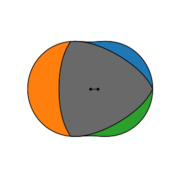

# Wankel engine: housing, rotor and chambers

The example is a Wankel engine with the numbers of Mazda's 13B: a generating radius `R` = 105, an eccentricity
`e` = 15 and a rotor width of 80. The housing of the rotary engine is an epitrochoid. The triangular rotor turns on an
eccentric at a third of the shaft speed, and its three flanks close three chambers that each grow and shrink twice
per rotor turn. The rotor is made with Boolean operations as whatever fits inside the housing in every position. Its
chambers come out of the housing minus the rotor, and their change in area times the width is the engine's
displacement per chamber, with the change in area 3√3 R e. Lengths are in mm.

{.result}

```python
import math
import matplotlib.pyplot as plt
from matplotlib.animation import FuncAnimation
from IPython.display import HTML
import planex as px
```

## The housing

The housing is the epitrochoid x = e cos 3α + R cos α, y = e sin 3α + R sin α, drawn as one periodic spline through
240 of its points. **Check:** its area is π (R² + 3 e²).

```python
R = 105.0
e = 15.0
angles = [2 * math.pi * n / 240 for n in range(240)]
points = [(e * math.cos(3 * t) + R * math.cos(t), e * math.sin(3 * t) + R * math.sin(t)) for t in angles]
housing = px.Face([px.Spline(points, periodic=True)])
print("area", housing.mass, "exact", math.pi * (R**2 + 3 * e**2))
```

```text
area 36756.63395917995 exact 36756.63404700058
```

## The rotor

The rotor's center runs on a circle of radius e while the rotor turns a third as fast as the shaft, so it turns once
in three shaft turns. Seen from the rotor, the housing moves, and the rotor is the intersection of all those views, here 180 of them
over the three shaft turns (Figure 1).

```python
def from_rotor(shaft):
    t = math.radians(shaft)
    return housing.Translated((-e * math.cos(t), -e * math.sin(t))).Rotated((0, 0), -shaft / 3)


rotor = px.Intersect([from_rotor(3 * 360 * n / 180) for n in range(180)])
```

```python
Row((housing, "The housing"), (rotor, "The rotor"),
    caption="The epitrochoid and what fits inside it in every position")
```

```text
<IPython.core.display.HTML object>
```

**Check:** the rotor's apexes run along the housing, so the more views there are, the closer they come to R from the
rotor's center. With 180 views, they fall short of it by a fraction of a micrometer:

```python
(x0, y0), (x1, y1) = rotor.bounding_box
print("rotor area", round(rotor.mass, 2), "reaches out to", x1, "R", R)
```

```text
rotor area 23065.27 reaches out to 104.99983877612173 R 105.0
```

## The chambers

At each shaft angle, the housing minus the placed rotor, cut by the three rays from the rotor's center through its
apexes, gives the three chambers. A chamber goes through its cycle in three shaft turns, and by symmetry, the three
chambers over one turn are equivalent to one chamber over three turns.

```python
def place(shaft):
    t = math.radians(shaft)
    center = (e * math.cos(t), e * math.sin(t))
    return rotor.Rotated((0, 0), shaft / 3).Translated(center), center


def chambers(shaft):
    body, center = place(shaft)
    gap = housing - body
    pieces = []
    for n in range(3):
        a0, a1 = (math.radians(shaft / 3 + 120 * q) for q in (n, n + 1))
        ray0 = (center[0] + 3 * R * math.cos(a0), center[1] + 3 * R * math.sin(a0))
        ray1 = (center[0] + 3 * R * math.cos(a1), center[1] + 3 * R * math.sin(a1))
        wedge = px.QuickSketch(center).Line(ray0).Line(ray1).Close().Face()
        pieces.append(gap * wedge)
    return pieces, gap


shafts = [3 * n for n in range(120)]
areas = [[piece.mass for piece in chambers(shaft)[0]] for shaft in shafts]
cycle = [a[0] for a in areas] + [a[1] for a in areas] + [a[2] for a in areas]
```

```python
Chart("shaft angle [°]", "chamber area [mm²]", curves={"one chamber": ([3 * n for n in range(360)], cycle)},
      title="The area of one chamber over its cycle of three shaft turns")
```

```text
<IPython.core.display.HTML object>
```

**Check:** the chamber area changes by 3√3 R e. Times the width of 80, that is the displacement per chamber. The
compression ratio leaves out the recess that real rotors have in each flank.

```python
swing = max(cycle) - min(cycle)
print("chamber area from", round(min(cycle), 2), "to", round(max(cycle), 2), "mm²")
print("change", swing, "exact", 3 * math.sqrt(3) * R * e)
print("displacement per chamber", round(swing * 80 / 1000, 1), "cm³")
print("compression ratio", round(max(cycle) / min(cycle), 1))
```

```text
chamber area from 471.82 to 8655.76 mm²
change 8183.940101464743 exact 8183.940065762946
displacement per chamber 654.7 cm³
compression ratio 18.3
```

## In motion

One full cycle of a chamber takes three shaft turns. The animation shows the three chambers in their colors, and the
eccentric as a line from the shaft to the rotor's center.

```python
colors = ("tab:blue", "tab:orange", "tab:green")
fig, ax = plt.subplots(figsize=(6, 6))


def frame(n):
    shaft = 18 * n
    ax.clear()
    pieces, gap = chambers(shaft)
    body, center = place(shaft)
    housing.Plot(ax=ax, face_col="whitesmoke", legend=False)
    for piece, color in zip(pieces, colors):
        piece.Plot(ax=ax, face_col=color, legend=False)
    body.Plot(ax=ax, face_col="dimgray", legend=False)
    ax.plot([0, center[0]], [0, center[1]], "o-", color="black")
    ax.set_aspect("equal", adjustable="box")
    ax.set_xlim(-130, 130)
    ax.set_ylim(-130, 130)
    ax.axis("off")


animation = FuncAnimation(fig, frame, frames=60, interval=80)
plt.close(fig)
HTML(animation.to_jshtml())
```

```text
<IPython.core.display.HTML object>
```
