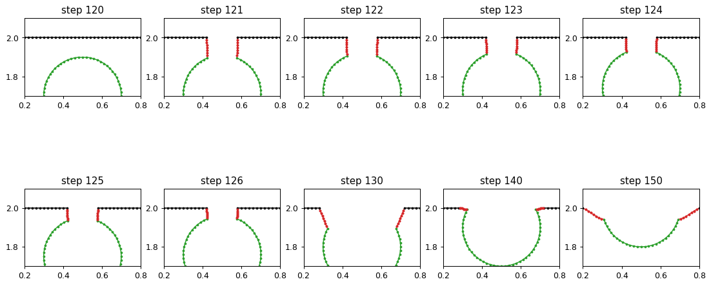
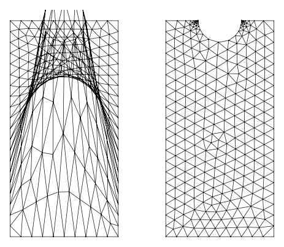

# Deformable shapes

- [Displacements and topology changes](displacements.md)
- [Displacements from NGSolve](ngsolve.md)

*Experimental: a proof of concept.*

A deformable shape represents a face as dense closed polylines whose vertices follow a displacement, given as an array
or as an NGSolve GridFunction. When parts of the boundary come closer than a minimum distance, the shape changes its
topology: a hole opens to the outside, and parts merge or split. `Shape()` returns the result as a planex2d shape at
any time, so netgen can mesh it again. This suits moving boundaries, such as shape optimization, erosion or growth,
where a mesh that is only deformed would degenerate.

In this section

[<b>Displacements and topology changes</b>A hole moved by a displacement array until it opens through the outline.](displacements.md)
[<b>Displacements from NGSolve</b>A GridFunction as the displacement, with netgen meshing the shape again after every step.](ngsolve.md)
