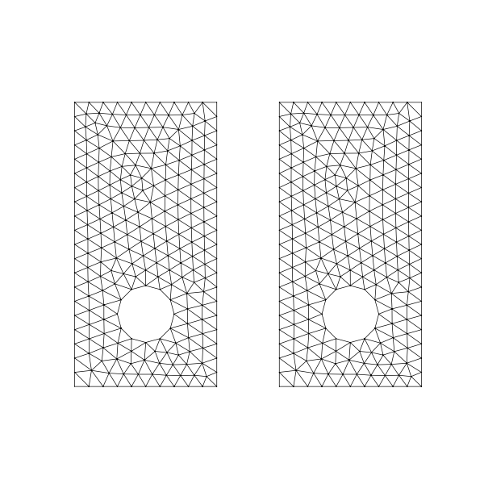
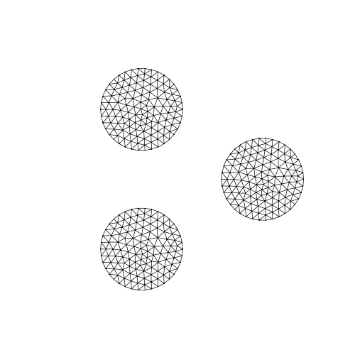

# Displacements from NGSolve

*Experimental: a proof of concept.*

The displacement of a deformable shape can also be a vector GridFunction on a mesh of the shape. `SetDeformation`
evaluates it on the boundary of the mesh, at every vertex of the polylines. The example is the plate from
[Displacements and topology changes](displacements.md), a square 2 × 2 with a hole of radius 0.4.

```python
import ngsolve as ngs
from ngsolve_webgpu.jupyter import Draw
import planex as px

face = px.QuickSketch().RectangleC(2, 2, name="outer").Circle(0, 0, 0.4, name="hole").Face()
shape = px.DeformableShape(face, h=0.05, min_distance=0.1)
```

## A harmonic extension

In every step, netgen meshes the current shape, and NGSolve computes a displacement that moves the hole up by `dy`
and keeps the outline in place. Inside the plate, the displacement is the harmonic extension of these boundary
values, which is the solution of a vector Laplace equation.

```python
def push(shape, dy=0.02):
    mesh = ngs.Mesh(px.OCCGeometry(shape.Shape()).GenerateMesh(maxh=0.1))
    mesh.Curve(2)
    fes = ngs.VectorH1(mesh, order=2, dirichlet="hole|outer")
    u, v = fes.TnT()
    a = ngs.BilinearForm(ngs.InnerProduct(ngs.Grad(u), ngs.Grad(v)) * ngs.dx).Assemble()
    gf = ngs.GridFunction(fes)
    held = mesh.BoundaryCF({"hole": ngs.CF((0, dy)), "outer": ngs.CF((0, 0))})
    gf.Set(held, definedon=mesh.Boundaries("hole|outer"))
    gf.vec.data += a.mat.Inverse(fes.FreeDofs()) * (-a.mat * gf.vec)
    return gf
```

The GridFunction goes directly into `SetDeformation`. The loop stops at the first topology change, and netgen
meshes the final shape.

```python
for step in range(40):
    if shape.SetDeformation(push(shape)):
        print("topology changed at step", step)
        break
mesh = ngs.Mesh(px.OCCGeometry(shape.Shape()).GenerateMesh(maxh=0.1))
mesh.Curve(3)
Draw(mesh)
```

```text
topology changed at step 24
```

```text
<IPython.core.display.HTML object>
```

## In motion

The animation shows the hole pushed up through the outline. On the left, the original mesh is only deformed, and its
elements degenerate. On the right, the deformable shape is meshed again whenever needed, and the hole opens into a
notch.



In the second animation, three discs move toward each other. Where two of them come closer than `min_distance`, they
are bridged, and the three discs become one body.


