# planex2d: fast, exact 2D geometry for Python

planex2d is a 2D geometry kernel for Python, written in C++. You draw outlines from lines, arcs, circles and splines, combine them with exact Boolean operations, dimension them with constraints, and clean up drawings imported from other tools. The resulting faces go to OpenCASCADE, netgen/NGSolve, gmsh and other tools for 3D modeling, meshing and simulation.

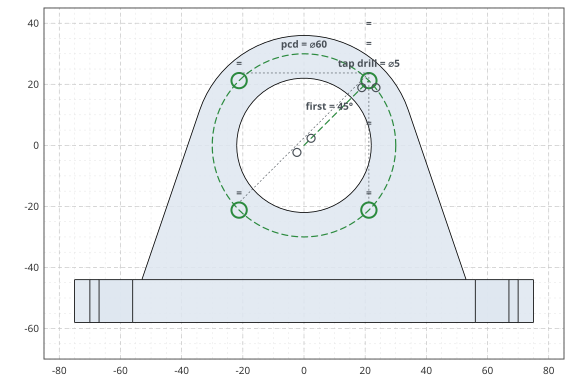

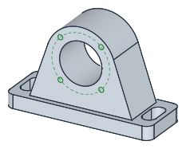

## Installation

``` bash
pip install planex2d
```

The package is called `planex2d` on PyPI and `planex` in Python (`import`` ``planex`` ``as`` ``px`). Version 0.1 has no prebuilt wheels yet, so pip builds it from source. See [Installation](core/installation.md) for the two extra steps this needs and for the optional packages.

## A first sketch

planex2d has two sketch types with the same drawing calls. A `QuickSketch` draws the geometry directly, and a `Sketch` also solves constraints (see [Sketching](#sketching) below). The simplest way to draw is with the pen. `Line` draws along the current direction, `Turn` changes the direction, `Arc` continues with a tangent arc, and `Close` joins the outline to its start. `Circle` adds a hole. The result is an angle bracket with an inner fillet and two holes.

``` python
import planex as px

bracket = px.QuickSketch()
bracket.Line(60).Turn(90).Line(10).Turn(90).Line(40)
bracket.Arc(10, -90).Line(30).Turn(90).Line(10).Close()
bracket.Circle(45, 5, 2.5).Circle(5, 35, 2.5)
face = px.Face(bracket.Wires())
face.Plot()
```

[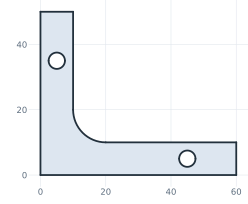](_images/landing-turtle.svg)

Geometry can also be defined by its relations to other elements instead of computed coordinates. The next sketch draws two bosses as construction circles, joins them with two tangent lines, and closes the outline with arcs that lie on the bosses’ circles. planex2d finds the tangent points. Slots, fillets, offsets, patterns and the other profile tools work the same way.

``` python
import planex as px

link = px.QuickSketch()
link.Circle(0, 0, 1.5, id="boss1", construction=True)
link.Circle(6, 0, 1.0, id="boss2", construction=True)
link.Line(tangent=("boss1", "boss2"), id="upper")
link.Line(tangent=("boss1", "boss2"), reverse=True, id="lower")
link.Arc("lower", "upper", congruent="boss2", id="end2")
link.Arc("upper", "lower", congruent="boss1", id="end1")
link.Circle(0, 0, 0.6, id="hole1").Circle(6, 0, 0.4, id="hole2")
face = px.Face(link.Wires())
face.Plot()
```

[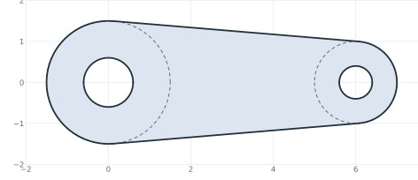](_images/landing-example.svg)

The [API conventions](core/conventions.md) describe the few rules the whole Python API follows.

## Speed

planex2d does only 2D geometry, embedded in 3D where needed, and is built for speed. In our benchmarks it is faster than general-purpose OpenCASCADE and several polygon libraries on most of the tested tasks, while keeping arcs and circles exact. See the [benchmark results](core/comparison/index.md) for the tests, the method and the timings.

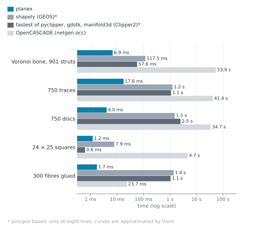\
Unions: planex2d vs polygon libraries vs OpenCASCADE

## How planex2d works

**Faces that touch share their edges exactly.** planex2d splits edges where they cross or overlap, keeps the pieces that belong to the result and joins them into its boundary. Each vertex is computed once and shared bit-exactly by the edges that meet there, so neighboring faces meet without gaps. The figure shows the same approach for an offset: each edge is offset on its own, the offset edges are cut where they cross, and the pieces that belong to the result form the new face.

[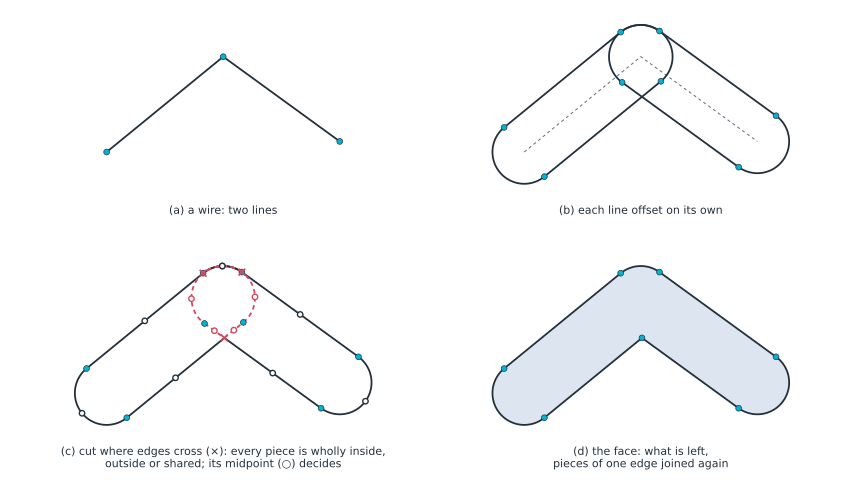](_images/how-offset.svg)

**Holes do not depend on drawing direction.** Whether a loop is material or a hole follows from how deep it is nested. A loop inside an odd number of other loops is a hole, and a loop inside an even number is material, however it was drawn.

[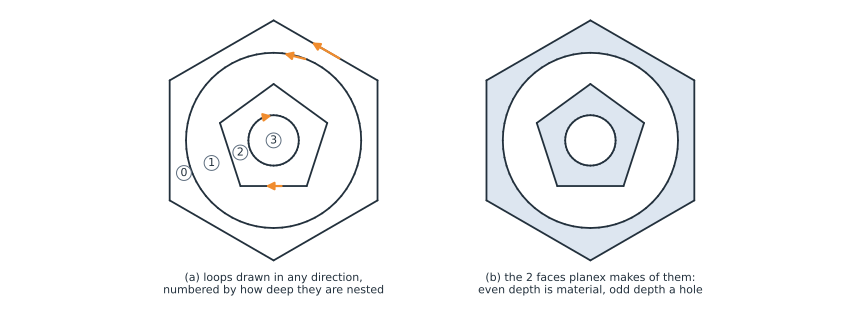](_images/how-nesting.svg)

**Imported drawings can be cleaned up.** Drawings from DXF files and other tools often have tiny gaps and very short edges, which get in the way of Boolean operations and meshing. `CloseGaps` snaps endpoints to nearby endpoints within a tolerance you give, and `RemoveSmallEdges` removes edges shorter than a given length and merges their ends. See [Small gaps](core/defeaturing/gaps.md) and [Small edges](core/defeaturing/small-edges.md) for details.

[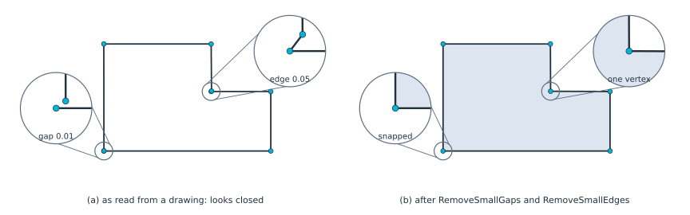](_images/how-cleanup.svg)

**Tessellated outlines can become curves again.** Outlines made of many short edges can be simplified. planex2d fits arcs to chains that are nearly circular and replaces runs of short edges along a smooth curve with one spline, within a tolerance you give. See [Defeaturing](core/defeaturing/index.md) for details.

[](_images/how-fitting.svg)

## Sketching

A `Sketch` adds a constraint solver to the same drawing calls. You add geometric constraints and dimensions, and the solver keeps them satisfied after every change. This is what makes parametric design possible: change a dimension later, and the drawing follows. See the guides to [quick sketches](core/sketch/index.md) and [constraint sketches](core/constraints/index.md).

In the example below, three lines are drawn roughly between two fixed circles. The constraints make each line tangent to both circles, with its ends on them. The solver starts from the rough drawing, so each line keeps the side and direction it was drawn with.

``` python
sk = px.Sketch()
sk.Circle(0, 0, 1.0, px.Fix, id="left")
sk.Circle(4, 0.5, 0.6, px.Fix, id="right")
sk.Move((-0.3, 1.4)).Line((4.2, 1.3), id="upper")
sk.Move((0.2, -1.3)).Line((4.1, -0.3), id="lower")
sk.Move((0.1, 1.2)).Line((3.6, -0.2), id="cross")
for line in ("upper", "lower", "cross"):
    sk.Constrain(line, "left", px.Tangent)
    sk.Constrain(line, "right", px.Tangent)
    sk.Constrain(line + ".start", "left", px.Coincident)
    sk.Constrain(line + ".end", "right", px.Coincident)
```

[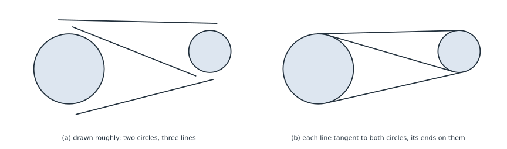](_images/how-tangent.svg)

A constraint sketch can describe a complete part. The tilt bracket (a) has bosses, tangent edges, R6 fillets and a curved slot centered on the pivot. The T-slot profile (b) dimensions one eighth of the section and builds the rest by symmetry. Green means the sketch is fully constrained. Named dimensions, such as the length of `AB`, can be changed later, and the sketch updates.

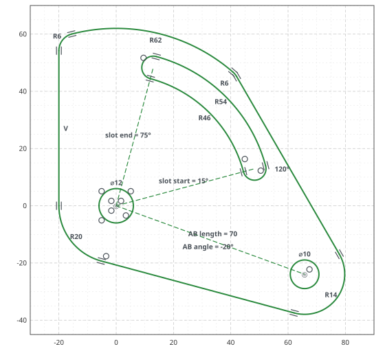\
(a) Tilt bracket

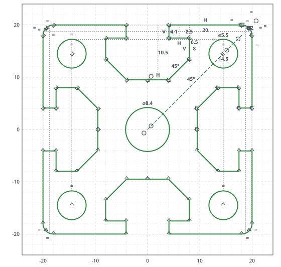\
(b) T-slot extrusion profile

**Parameter sweeps.** Because a constraint sketch can be updated, one parametric sketch can produce a whole family of designs. The meander inverted-F antenna below is one sketch: a linear pattern repeats the meander, and the depth, pitch, feed offset and number of meanders are dimensions. Each design is one call to `Update` on the same sketch, here the one for design (b). The copper is the center line offset by half the trace width.

``` python
antenna.Update({"meanders.count": 4, "depth": 5, "pitch": 2, "feed offset": 2})
```

[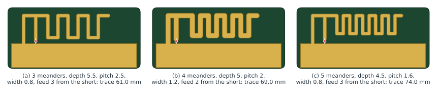](_images/how-sweep.svg)

## Optimization

planex2d works with numerical optimizers. In the 3D cold plate example, SciPy’s COBYLA optimizer moves four points of a constrained pipe sketch. Each candidate layout is meshed by netgen and solved in NGSolve for the oil flow and the plate temperature in 3D. The optimizer lowers the hottest temperature while keeping the pressure drop within a limit.

``` python
from scipy.optimize import minimize

result = minimize(pnorm, x0, method="COBYLA", constraints=limits)
```

Here `pnorm` builds and solves one layout and returns a smooth measure of the hottest temperature, and `limits` keep the pipe’s bends, clearances and pressure drop within bounds. The figures compare the straight pipe the optimizer starts from, the best layout it found, and that layout in 3D.

[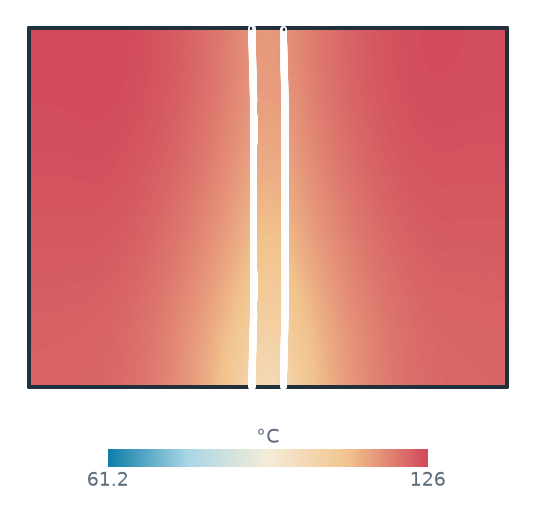](integrations/scipy-cold-plate.md)\
(a) Initial straight pipe

[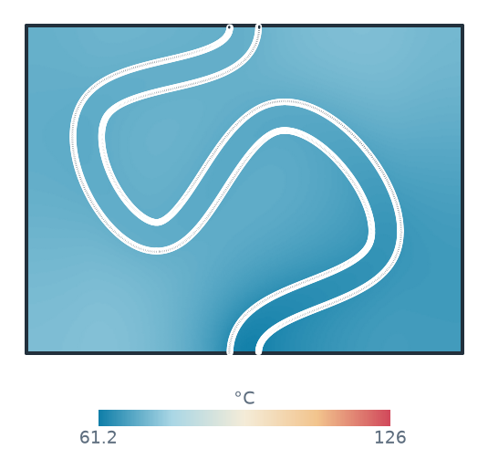](integrations/scipy-cold-plate.md)\
(b) Optimized pipe layout

[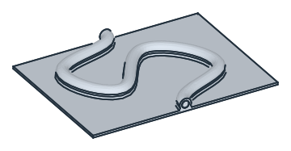](integrations/scipy-cold-plate.md)\
(c) Optimized layout in 3D

## Using the solver directly

The constraint solver is not limited to drawings. It can solve mechanisms and other geometric systems whose positions follow from dimensions and relations. One sketch models Jansen’s walking leg, with the crank angle updated for each frame (a). Another sweeps the cylinder lengths of an excavator arm to find the reach of its tooth (b). The same arm also solves the other way round: give the tooth’s position and the bucket angle, and the solver returns the cylinder lengths (c).

This shows where the tooth can reach a level floor and where the cylinders’ stroke limits make a position impossible. See the [excavator arm example](examples/excavator-arm.md) for the complete model.

\
(a) Jansen's leg: one sketch, the crank angle updated

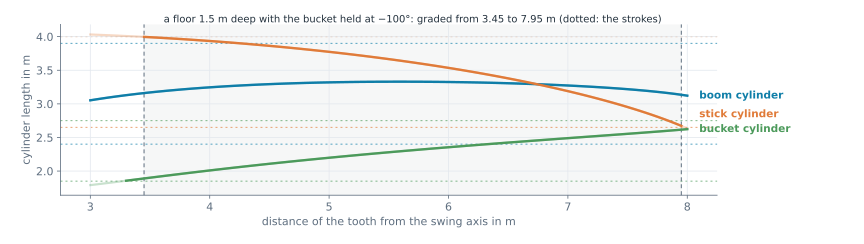\
(c) Cylinder lengths for a level floor 1.5 m deep, with the bucket held at −100°

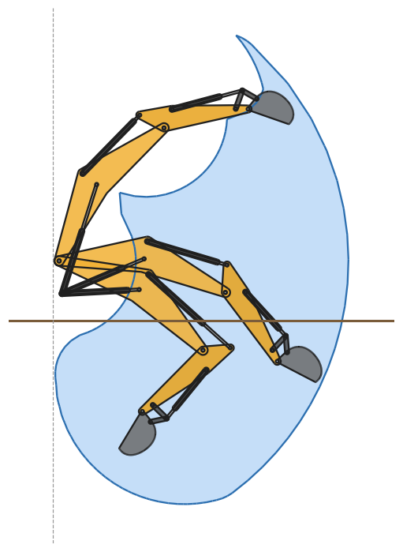\
(b) Reach of an excavator's tooth

## Integrations: import and export

planex2d passes faces to OpenCASCADE, netgen/NGSolve and gmsh, and reads geometry from KiCad, DXF and shapely.

The examples show a tilt bracket extruded and analyzed in NGSolve (a), a face meshed with quadrilaterals by gmsh (b), and a KiCad board read with its copper and drill holes (c). The board is the [pic_programmer](https://gitlab.com/kicad/code/kicad/-/tree/master/demos/pic_programmer) demo from the KiCad project. Its image is reproduced under the same [CC BY-SA 4.0 license](https://creativecommons.org/licenses/by-sa/4.0/).

[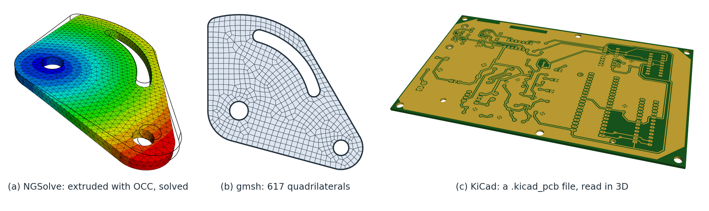](_images/how-integrations.png)

## Examples

[](examples/toy-plane.md)


**Toy plane**A toy airliner built from sketches, with its fuselage, wings and engines lofted through sections. [](examples/motor.md)

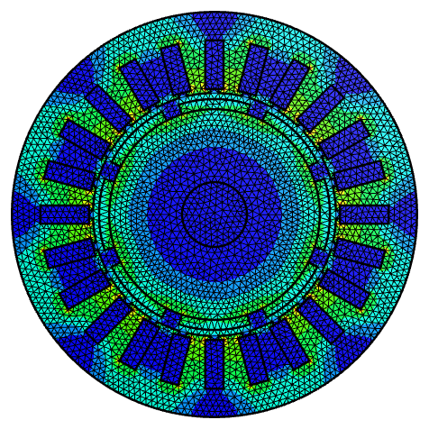

**Surface magnet motor**A lamination glued into regions, its field, and a 12-slot design under load. [](examples/excavator-arm.md)


**Excavator arm**A 20-tonne excavator modeled as a constraint sketch, with 6,615 solved positions used to calculate the tooth's reach. [](examples/slicer.md)


**A slicer for 3D printing**A STEP part sliced into layers, each converted into perimeters and infill. [](examples/spur-gears.md)

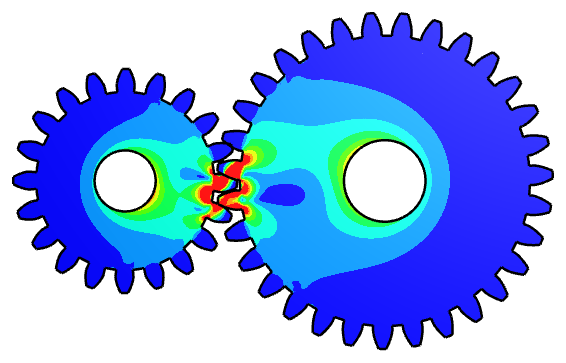

**Spur gears under load**Involute gears constructed tooth by tooth, meshed and loaded to calculate stress at the contact. [](examples/voronoi-bone.md)


**Voronoi bone**Thousands of struts combined into a scaffold for stiffness analysis and comparison with a scaling law.

See the [full example collection](examples/index.md), from mechanisms and antennas to meshing and simulation. Each example is checked against a formula or a measured property.

## License

planex2d is free software under the GNU Lesser General Public License, version 2.1 or later. It includes code from Eigen, pybind11 and Taskflow, uses the Netgen library, and makes use of facilities provided by Open CASCADE Technology. See [License and notices](core/notices.md) for the licenses and notices.
