# netgen and NGSolve

[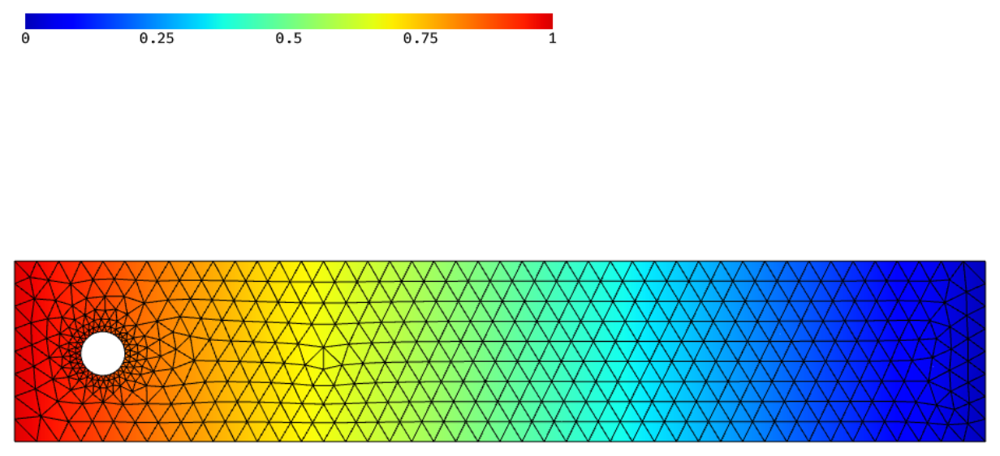A potential flow on the mesh of a planex2d face](../../integrations/netgen/meshing.md)
[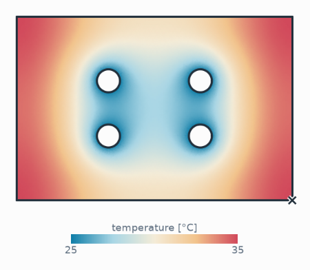A cold plate&#x27;s temperature as a measurement](../../integrations/netgen/field-solvers.md)
[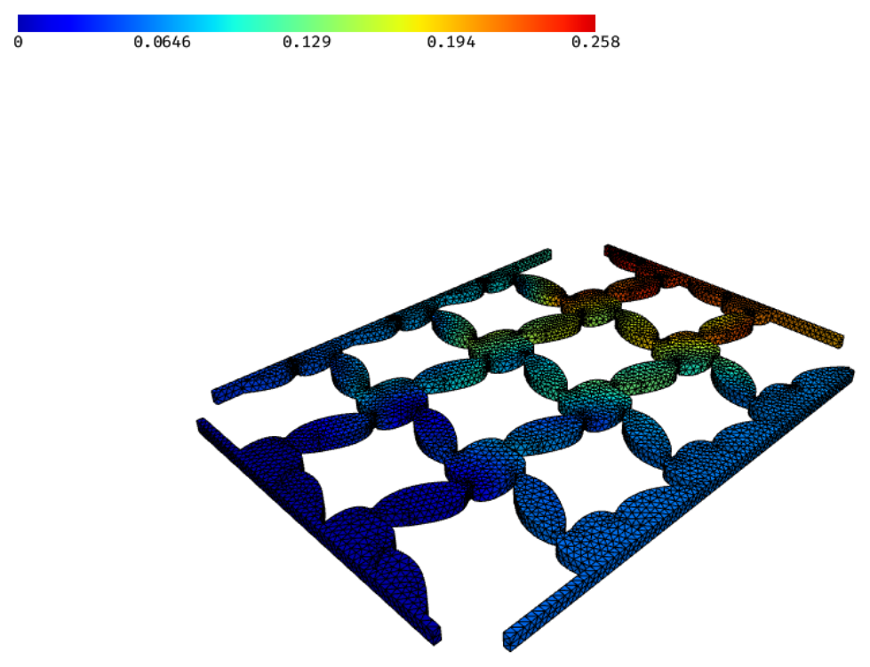An auxetic lattice from a level set, loaded](../../integrations/netgen/levelset.md)

planex2d faces and shapes become netgen geometries in one call. The geometry reaches netgen through OpenCASCADE, in the
build that netgen ships as `netgen-occt`, so everything on the [OpenCASCADE](../occ/index.md) pages applies here too,
and every plane argument takes netgen's `occ.Axes` besides a `px.Plane`. Face names turn into materials, edge names into
boundary conditions, and vertex names into point names. `maxh` and `hpref` on faces, edges and vertices set the mesh
size and refine towards corners. Faces glued into a shape share their edges, so the regions of the mesh fit together
without gaps. Results come back onto the geometry: `px.PlotField` draws NGSolve and FEniCSx fields on the exact planex2d
geometry, also in cuts through 3D parts. A measurement can pass the part to netgen for meshing and to NGSolve for
solving, and `px.FromLevelSet` turns a level set function into a planex2d shape.

In this section

## Getting started

- [Coming from netgen's WorkPlane](workplane.md)
- [Naming and marking](naming.md)
- [Identifications](identifications.md)

[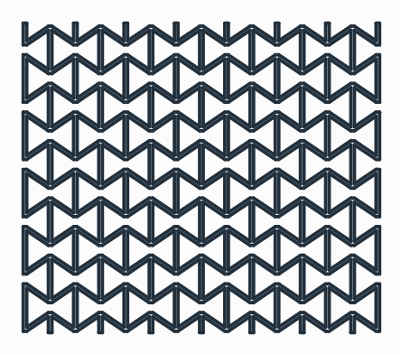<b>Coming from netgen&#x27;s WorkPlane</b>Drawing code for netgen&#x27;s WorkPlane run unchanged on px.WorkPlane, or taken over with px.FromOCC.](workplane.md)
[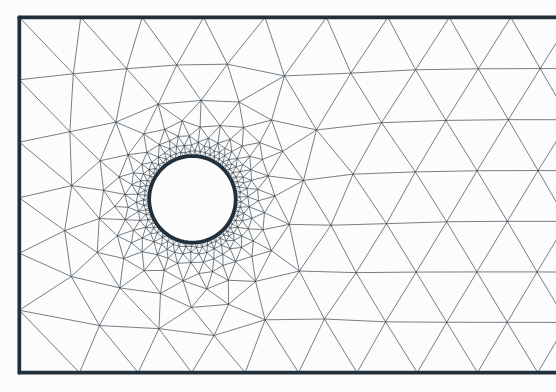<b>Naming and marking</b>Names, mesh sizes and refinement set while drawing or afterwards, and how netgen reads them.](naming.md)
[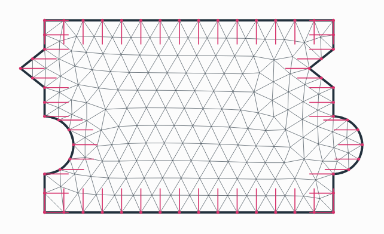<b>Identifications</b>Periodic unit cells and rotational sectors, with the transformation found automatically.](identifications.md)

## Meshing and fields

- [Meshing a face](meshing.md)
- [Fields and cuts](fields.md)
- [Solids and meshes in the webgui](webgui.md)
- [Field solvers as measurements](field-solvers.md)
- [From level sets](levelset.md)

[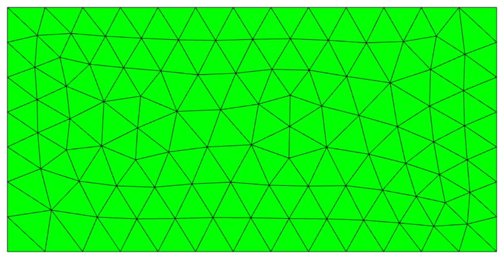<b>Meshing a face</b>A named planex2d face meshed by netgen, with a potential flow, regions and corner refinement.](meshing.md)
[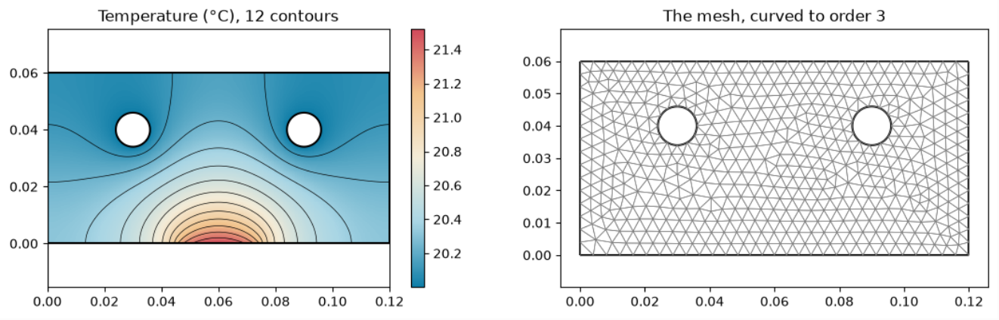<b>Fields and cuts</b>Temperatures, fluxes, arrows and field lines on curved meshes and in cuts through 3D parts.](fields.md)
[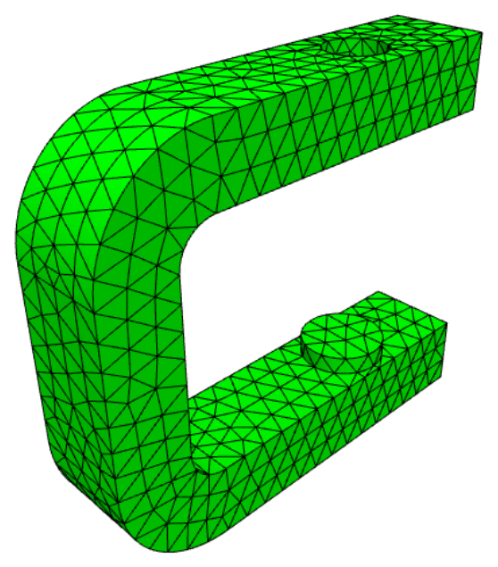<b>Solids and meshes in the webgui</b>OpenCASCADE solids from planex2d faces and the meshes netgen makes of them.](webgui.md)
[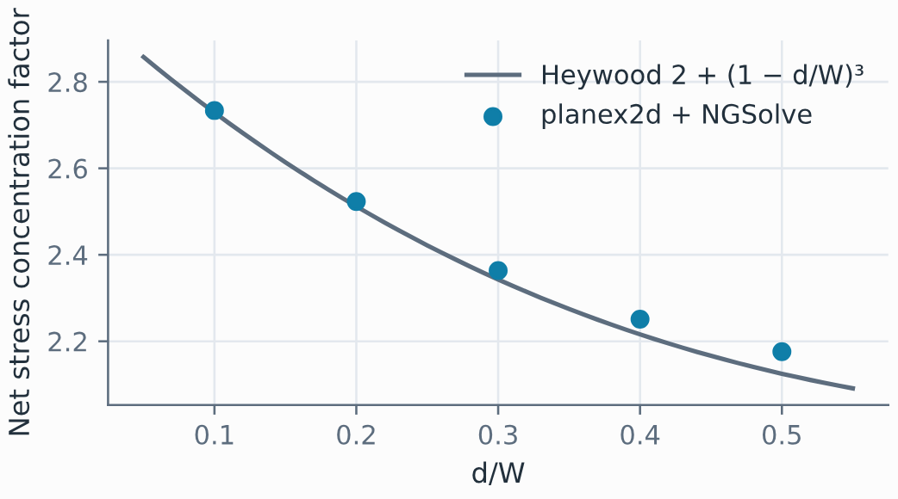<b>Field solvers as measurements</b>Peak temperature and stress concentration as numbers on a sketch, checked against closed forms.](field-solvers.md)
[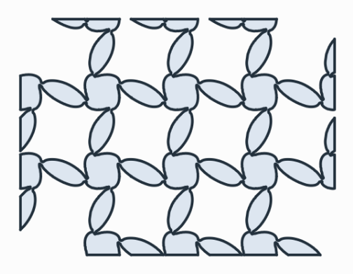<b>From level sets</b>The region where a level set function is positive, as a planex2d shape, shown on an auxetic lattice.](levelset.md)
