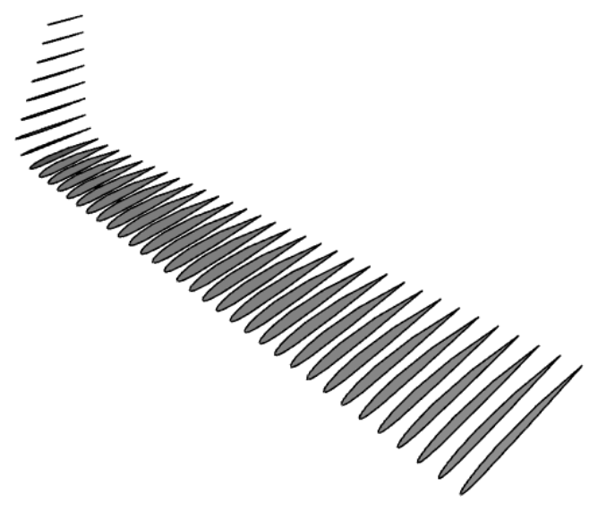
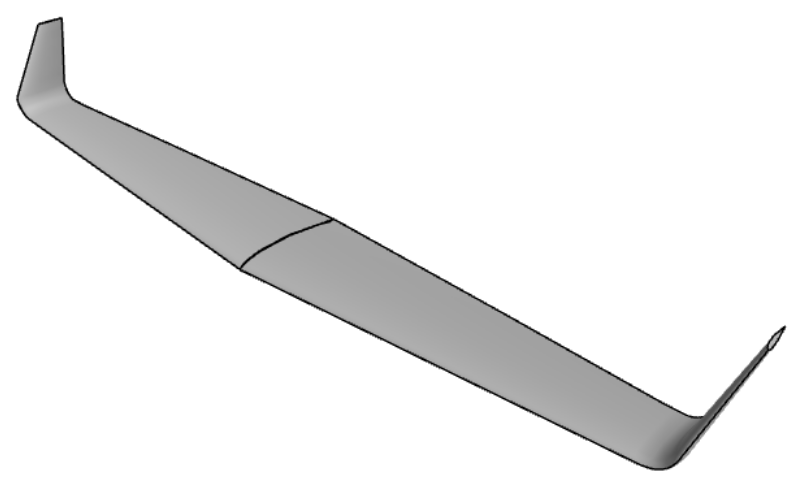
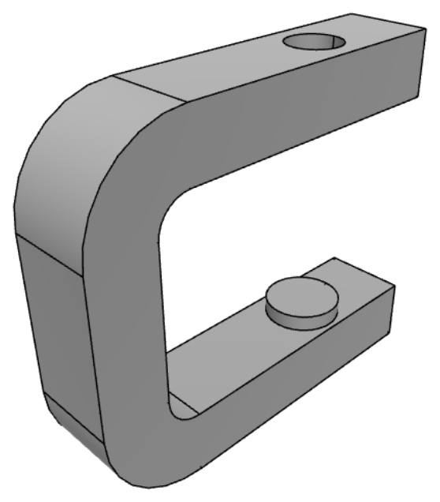
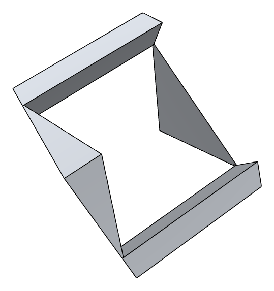
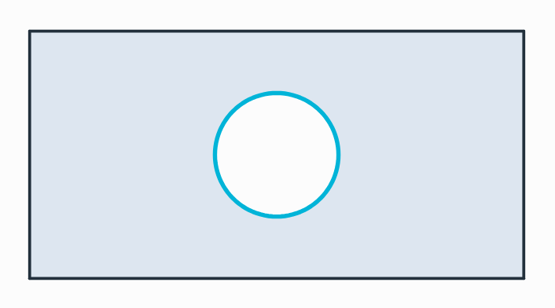
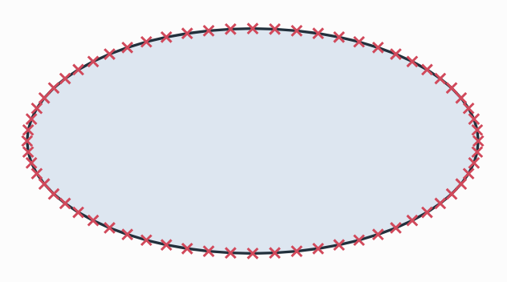
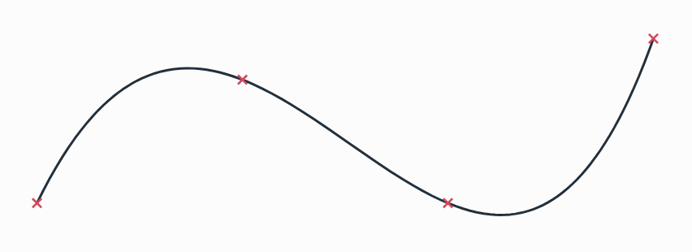
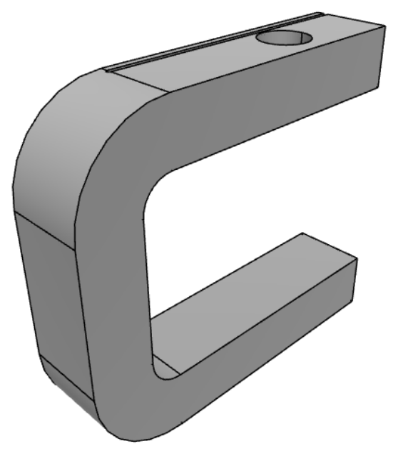
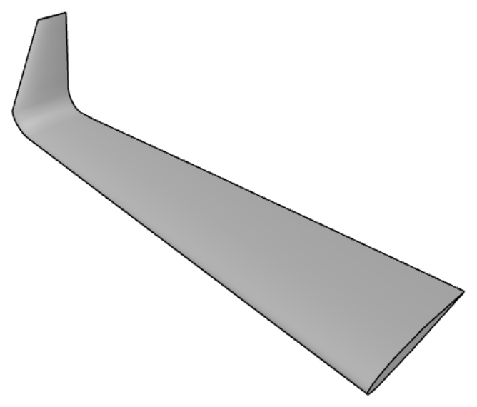

# OpenCASCADE

[Airfoil sections on their planes in space](../../integrations/occ/loft.md)
[The wing lofted through them](../../integrations/occ/loft.md)
[A C-clamp from one sketch](../../integrations/occ/clamp.md)
[<em class="px-tag">Example</em> Prince Rupert&#x27;s cube: a cube through a cube](../../examples/prince-ruperts-cube.md)

A planex2d object lies on a plane in 3D, so its faces and wires become OpenCASCADE shapes as they are: exact lines,
arcs, full circles and B-splines with shared vertices. They can be extruded, revolved and lofted into solids or cut
from solids, and a sketch can be drawn on the face of a solid with the solid's edges projected into it. Names, colors
and mesh sizes travel with the edges and faces into the solid, where netgen reads them as boundaries, materials and
mesh sizes. The export can clean up the geometry on the way out, fit splines, and write arcs for tools that accept
nothing else. It needs netgen's OpenCASCADE (`pip install netgen-mesher`). Planes are `px.Plane` objects on these
pages; every plane argument also takes netgen's `occ.Axes`, so existing netgen code can pass its axes unchanged (see
[API conventions](../../core/conventions.md)).

In this section

## Export

- [To OCC shapes](export.md)
- [Export options](export-options.md)
- [Splines as arcs](splines-as-arcs.md)

[<b>To OCC shapes</b>Faces, wires and sketches as OpenCASCADE shapes, with names and colors kept.](export.md)
[<b>Export options</b>Cleanup on the way out, with fitted splines, joined lines and open wires.](export-options.md)
[<b>Splines as arcs</b>The chain of arcs planex2d computes with, for tools that accept only lines and arcs.](splines-as-arcs.md)

## Modeling

- [A C-clamp, step by step](clamp.md)
- [Sketching on and projecting 3D geometry](projecting.md)
- [Lofting sections](loft.md)
- [Lofts with guide curves](guided-loft.md)

[<b>A C-clamp, step by step</b>A profile drawn with the pen, followed by the frame, screw hole, anvil pad, mesh and STEP file.](clamp.md)
[<b>Sketching on and projecting 3D geometry</b>A sketch on a face of a solid, with edges projected as targets for a marking groove.](projecting.md)
[<b>Lofting sections</b>NACA sections on planes along the span, lofted into a wing.](loft.md)
[<b>Lofts with guide curves</b>Sections cut from guide curves, with a plain and a guided loft.](guided-loft.md)

## Everything at a glance

| | |
|---|---|
| **Export** | `ToOCCShape()`, `ToOCCFace()`, `ToOCCWire()`, `ToOCCWires()`, with the cleanup options of `Simplify` (see [Export options](export-options.md)) |
| **Solids** | `px.Pad(profile, length)` and `px.Pocket(target, profile, length)`, with `length2`, `dir`, `reverse` and `until`; OpenCASCADE's own operations on the exported shapes, such as `Extrude` and `occ.ThruSections` |
| **Sketching on solids** | `px.QuickSketch(face)` and `px.Sketch(face)` on a planar face, `sk.Project(edge)` for its edges as references (see [Placing a sketch](../../core/sketch/placement.md)) |
| **Back into planex2d** | `px.FromOCC(shape or file)`, `px.Project(shape, plane)`, `px.Intersect3d(plane, shape)` |
| **Drawing** | `px.Plot3d(objects)` in 3D, `px.Plot(shape, plane)` for a section |
| **Meshing** | `px.OCCGeometry(face)` for netgen (see [netgen and NGSolve](../netgen/index.md)) |
